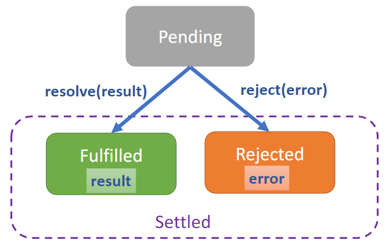

# 1. Index


# 2. AJAX

# 1. AJAX

Il _JS_ è un lingauggio _event-based_, dove il codice viene eseguito in risposta ad eventi tramite _callback_ di funzione.

Un esempio può essere un timer:

```js
let counter = 0;

function mycallback() {
  console.log("Counter: " + counter++);
  if (counter == 5) clearTimeout(timehandle);
}

let timerhandle = setInterval(mycalback, 1000);
```

O in risposta ad eventi triggerati dall'utente:

```html
<!DOCTYPE html>
<head>
  <meta charset="utf-8" />
  <title>Reacting to user's input</title>
  <script>
    function mycallback() {
      alert("Hi!");
    }

    function init() {
      const b = document.getElementById("btn");
      b.addEventListener("click", mycallback);
    }
    window.onload = init;
  </script>
</head>
<body>
  <button id="btn">Press Me</button>
</body>
```

Per utilizzare il _network in modo asincrono_ e creare appllicazioni web interattive si utilizzano una serie di tecniche _client-side_ di **Asynchronous JavaScript and XML** (**_AJAX_**).

<div class="grid2">
<div class="">

Tramite queste tecniche le applicazioni web possono ricevere dati dal server in maniera asincrona senza interferire con il comportamento/il display della pagina.

Le richieste sono tutte **eseguite in background**, tramite **XMLHttpRequest**.
L'idea di quella di **non caricare una nuova pagina** ogni volta

</div>
<div class="">


</div>
</div>

Consideriamo ad esempio una pagina dove vogliamo vedere il _current server time_.
Fin'ora quello che potevamo fare era ricaricare ogni volta l'intera pagina o inserire eventi particolari da triggerare.
Tramite le funzioni asincrone è invece possibile mantenere la pagina integra e andare a modificare solo l'elemento desiderato traimte chiamate "automatiche" alla funzione che aggiorna.

Le funzioni asincrone permettono anche di eseguire richieste `GET`/`POST` mantenendo la pagina attuale aperta ed effettuando una richiesta che può anche dare un risultato immediato.


## 1.1. Richieste `XMLHttp`

Le `XMLHttpRequest` sono utilizzate per inviare richieste `http`/`https` ad un _webserver_.

I dati ricevuti dal server possono essere _documenti `XML`_, `JSON` o file `txt`.
La risposta del server può essere utilizzata direttamente per modificare il `DOM` della pagina web attiva nella finestra del _browser_.

Per inviare una nuova richiesta dobbiamo creare rima un'oggetto, per poi specificargli l'_URL_ e il metodo di richiesta.

```js
let x = new XMLHttpRequest();

x.open("GET" /*URL dei dati*/);
x.send();
```

Quando la _transazione è completa_, l'oggetto conterrà la **risposta del server** e **lo stato `HTTP`**.

E' possibile eseguire queste richieste anche in funzioni _sincrone_, tuttavia mediamente queste richieste impiegano **molto tempo**, e bloccano l'esecuzione corretta della pagina.

Ad esempio:

```html
<!DOCTYPE html>
<head>
  <meta charset="utf-8" />
  <title>Reacting to user's input</title>
  <script src="xmlreqexample.js"></script>
</head>
<body>
  <button id="btn">Press Me</button>
</body>
```

<div class="grid2">
<div class="top">

```js
function success(text) {
  const p = document.createElement("p");
  document.body.appendChild(p);
  p.innerText = "The reply is: " + text;
}
function fail(text) {
  const p = document.createElement("p");
  document.body.appendChild(p);
  p.innerText = "Problem: " + text;
}
function init() {
  const b = document.getElementById("btn");
  b.addEventListener("click", startrequest);
}

window.onload = init;
```

</div>
<div class="top">

```js
function startrequest() {
  const x = new XMLHttpRequest();
  x.open("GET", "http://localhost/xmlrequest/long.php");
  x.onload = function () {
    console.log("Reply received");
    x.status == 200 ? success(x.response) : fail(x.statusText);
  };
  x.onerror = function () {
    // Eseguito se la richiesta non può essere effettuata
    fail("Network Error");
  };
  x.send(); // Viene considerata come se avesse ritorno immediato
  console.log("Request sent");
}
```

```php
// --- PHP --- //
// Attende 3 secondi
sleep(3);
echo "69";
```

</div>
</div>

Altri metodi utili delle richieste sono:

<div class="flexbox"><span class="index">

|       Metodo       |                        Parametri                        | Descrizione                           |
| :----------------: | :-----------------------------------------------------: | :------------------------------------ |
|       `send`       |        `string`: utilizzata per richieste `POST`        | Invia una richiesta al server         |
| `setRequestHeader` | `header`: l'_header name_ <br> `name`: l'_header value_ | Aggiunge _header HTTP_ alla richiesta |

</span></div>

Un esempio di utilizzo di questi metodi:

```js
xmlhttp.open("POST", "myscript.php");
xmlhttp.setRequestHeader("Content-type", "application/x-www-form-urlencoded");
xmlhttp.send("name=Mario&age=33");
```

Un esempio più generico invece:

```html
<!DOCTYPE html>
<title>Waiting for Magical Unicorns</title>
<progress id="p"></progress>
<script>
  var progressBar = document.getElementById("p"),
    client = new XMLHttpRequest();
  client.open("GET", "magical-unicorns");
  client.onprogress = function (pe) {
    if (pe.lengthComputable) {
      progressBar.max = pe.total;
      progressBar.value = pe.loaded;
    }
  };
  client.onloadend = function (pe) {
    progressBar.value = pe.loaded;
  };
  client.send();
</script>
```

## 1.2. `Fetch`

`Fetch` è una versione moderna delle `HttpRequest`.
Permette di scrivere del codice più lineare rispetto ad avere livelli di callback multipli, e gestire meglio gli errori.

Si basa sul concetto delle _Promises_ per gestire l'asincronia.

Una **Promise** è un oggetto che rappresenta il risultato futuro di un'operazione asincrona.

<div class="grid2">
<div class="">

Una _promise_ può essere:

- `pending`: è lo stato iniziale, non è stata completata né rifiutata
- `fulfilled`: l'operazione è stata _completata in maniera corretta_
- `rejected`: l'operazione è _fallita_

Possiamo associare degli handler agli stati `fulfilled` e `rejected`

</div>
<div class="">


</div>
</div>

Per associare delle azioni alle promesse si utilizzano:

<div class="flexbox"><span class="">

|   Metodo    | Descrizione                                                                                                                      |
| :---------: | -------------------------------------------------------------------------------------------------------------------------------- |
|  `then()`   | Imposta l'handler in caso di _fulfillment_. <br> <small>(Può essere utilizzata anche per gestire lo stato di _rejected_)</small> |
|  `catch()`  | Imposta l'_handler_ nello stato _rejected_                                                                                       |
| `finally()` | Imposta l'_handler_ nello stato _settled_                                                                                        |

</span></div>

Alcuni esempi impostando la seguente _Promise_

```js
let prom1 = new Promise(function (res, rej) {
  /*
   * Codice eseguito quando la promessa è creato
   * Impiega generalmente del tempo per essere completato
   */
  console.log("1");

  // Simuliamo una computazione con un ciclo inutile
  for (let i = 0; i < 100000000; i++);

  /*
   * Quando la computazione termina:
   *   - Se succesfull, restituisce i risultati tramite il primo argomento.
   *     In questo esempio è "res", ma è spesso chiamato "resolve".
   *   - Se unsuccessful, restituisce il perché è fallita tramite il secondo argomento.
   *       In questo esempio è "rej", ma è spesso chiamato anche "rejected"
   */

  if (Math.random() < 0.5) res("value 1");
  else rej("reason 1");
});
```

<div class="grid2">
<div class="top">
<p class="subt">

`then()`

 </p>

```js
prom1.then(
  // Il primo argomento è la funzione da eseguire quando si ha successo
  function (risultato) {
    console.log("Risultato: " + risultato);
  },
  // Il secondo argomento è la funzione da eseguire quando si fallisce
  function (errore) {
    console.log("Errore: " + errore);
  },
);

console.log("2");
```

> promise node promise1.js
> 1
> 2
> Errore: reason 1
> promise node promise1.js
> 1
> 2
> Risultato: value 1

</div>
<div class="top">
<p class="subt">

`catch`

</p>

```js
/*
 * Gli handler dei due casi possono essere separati meglio utilizzando:
 *   - then per la "resolve"
 *   - catch per il fallimento
 */
prom1.then(function (risultato) {
  console.log("Risultato: " + risultato);
});

prom1.catch(function (errore) {
  console.log("Errore: " + errore);
});

console.log("2");
```

> promise node promise2.js
> 1
> 2
> Risultato: value 1

Questo metodo può generare `ERR_UNHANDLED_REJECTION` nel caso in cui la _Promise_ fallisca **prima** che il `catch` venga impostato.

</div>
</div>

Il metodo generalmente migliore però è il seguente:

```js
new Promise(function (res, rej) {
  console.log("1");

  for (let i = 0; i < 100000000; i++);
  Math.random() < 0.5 ? res("value 1") : rej("reason 1");
})
  .then(function (risultato) {
    console.log("Risultato: " + risultato);
  })
  .catch(function (errore) {
    console.log("Errore: " + errore);
  });

console.log("2");
```

> promise node promise3.js
> 1
> 2
> Errore: reason 1

Vediamo un'ulteriore esempio utilizzando `setTimer()`, _arrow function_ e `finally`:

```js
console.log("Creating the Promise and specifying the handlers");

new Promise(function (resolve, reject) {
  console.log("Starting a timer");
  setTimeout(() => {
    Math.random() < 0.5 ? resolve("value 1") : reject("reason 1");
  }, 2000);
})
  .then((risultato) => {
    console.log("Risultato: " + risultato);
  })
  .catch((errore) => {
    console.log("Errore: " + errore);
  })
  .finally(() => console.log("Finally"));

console.log("I'm here");
```

> -> promise node promise4.js
> Creating the Promise and specifying the handlers
> Starting a timer
> I'm here
> ... 2 seconds ...
> Risultato: value 1
> Finally

Un ulteriore metodo è con le:

```js
console.log("Creating the Promise and specifying the handlers");
new Promise(function (resolve, reject) {
  console.log("Starting a timer");
  setTimeout(() => resolve("value 1"), 2000);
  // La prima promessa si risolve solo con sucesso dopo 2 secondi
}).then((risultato) => {
  console.log("In first then");
  // Genero una seocnda promessa
  new Promise(function (res, rej) {
    setTimeout(() => res(risultato + ", value 2"), 3000);
    // Avrà risultato positivo dopo 3 secondi
  }).then(
    // Il risultato della seconda promessa
    (risultato2) => {
      console.log("All results: " + risultato2);
    },
  );
});
console.log("I'm here");
```

> -> promise node promise5.js
> Creating the Promise and specifying the handlers
> Starting a timer
> I'm here
> ... 2 seconds ...
> In first then
> ... 3 seconds ...
> All results: value 1, value 2

Un metodo migliore per fare l'ultima cosa vista:

```js
console.log("Creating the Promise and specifying the handlers");
new Promise(function (resolve, reject) {
  console.log("Starting a timer");
  setTimeout(() => resolve("value 1"), 2000);
})
  .then((risultato) => {
    console.log("First promise resolved");
    return new Promise(function (res, rej) {
      setTimeout(() => res(risultato + ", value 2"), 3000);
    });
  })
  .then((risultato2) => {
    console.log("Second promise resolved: " + risultato2);
  });

console.log("I'm here");
```

> promise node promise6.js
> Creating the Promise and specifying the handlers
> Starting a timer
> I'm here
> ... 2 seconds ...
> First promise resolved
> ... 3 seconds ...
> Second promise resolved: value 1, value 2

Un esempio di utilizzo della `fetch`:

```js
function addrow(n, u, v, t) {
  const t1 = document.getElementById("t1");
  const li = document.createElement("li");
  const text = document.createTextNode(n + ", " + u + ", " + v + ", " + t);
  li.appendChild(text);
  t1.appendChild(li);
}

function loadfromservice() {
  fetch("https://api.coingecko.com/api/v3/exchange_rates")
    .then((res) => res.json())
    .then((data) => {
      const rat = data.rates;
      for (const key in rat) {
        addrow(rat[key].name, rat[key].unit, rat[key].value, rat[key].type);
      }
    });
}
```

Nella generica chiamata:

```js
fetch("https://api....")
  .then((res) => res.json())
  .then((data) => {
    /* actions ... */
  });
```

- La `fetch` restituisce un primo oggetto _Promise_.
  La richiesta _HTTP_ viene inviata all'_URL_ specificato registrando gli _handler_
- Quando vengono ricevuti lo stato HTTP e gli _headers_, la prima promessa è _resolved_, e viene eseguito **il primo `then`**
- `res.json()` ritorna una seconda promessa, gestita dal **secondo `then`**
- `data` è l'oggetto restituito.

## 1.3. `async` e `await`

Sono state introdotte per semplificare il codice _promise-based_.

Una funzione può essere dichiarata `async`, e dovrà ritornare una _Promise_.
La loro esecuzione verrà effettuata in _background_ senza interrompere il _flow_ della pagina.

```js
async function myfunction1() {
  return 42;
  // Convertito in una fulfilled Promise
}
async function myfunction2() {
  return Promise.resolve(42);
}

myfunction1().then((r) => {
  console.log(`The answer is ${r}`);
});
myfunction2().then((r) => {
  console.log(`The answer is ${r}`);
});
```

Nel caso di `rejection` **genera un eccezione**.

```js
async function myfunction1(z) {
  if (z > 0.5) return z;
  else throw "Wrong z value";
}

async function myfunction2(z) {
  if (z > 0.5) return Promise.resolve(z);
  else return Promise.reject("Wrong z value");
}
const z = Math.random();

myfunction1(z)
  .then((r) => {
    console.log(`The answer is ${r}`);
  })
  .catch((e) => {
    console.log(`There was a problem: ${e}`);
  });

myfunction2(z)
  .then((r) => {
    console.log(`The answer is ${r}`);
  })
  .catch((e) => {
    console.log(`There was a problem: ${e}`);
  });
```

> async-await node async2.js
> The answer is 0.7867358165194982
> The answer is 0.7867358165194982
> async-await node async2.js
> There was a problem: Wrong z value
> There was a problem: Wrong z valueù

`await` è utilizzato per chiamare le funzioni `async` e attendere la loro _promise_ finchè non è _settled_.
Se `fulfilled` ritorna un valore, altrimenti un'_eccezione_.

```js
async function myfunction() {
  console.log("In myfunction");
  const z = Math.random();
  if (z > 0.5) return z;
  else throw "Wrong z value";
}

async function otherfunction() {
  try {
    console.log("Before calling myfunction");
    const r = await myfunction(); // attendo la risposta
    console.log(`The answer is ${r}`);
  } catch (e) {
    console.log(`There was a problem: ${e}`);
  }
}

otherfunction().then(() => {
  console.log("Execution completed");
});
```

> async-await node async3.js
> Before calling myfunction
> In myfunction
> There was a problem: Wrong z value
> Exceution completed
> async-await node async3.js
> Before calling myfunction
> In myfunction
> The answer is 0.9848621870426133
> Execution completed

```js
async function f1() {
  try {
    const r1 = await Promise.resolve(42);
    // Genero una promessa fulfilled
    console.log(`The result is ${r1}`);
    const r2 = await Promise.reject("Not fulfilled");
    // Genero una promessa rejected
    console.log("I'm here");
  } catch (e) {
    console.log(`There was a problem: ${e}`);
  }
}

f1().then(() => {
  console.log("Execution completed");
});
```

> async-await node async4.js
> The result is 42
> There was a problem: Not fulfilled
> Execution completed

Un esempio di utilizzo di queste _keyword_:

```html
</head>
<body>
    <p>Rates downloaded from https://api.coingecko.com/api/v3exchange_rates
    using a fetch</p>
    <button onclick="myf()">Download</button>
    <ul id="t1"></ul>
</body>
```

<div class="grid2">
<div class="top">

```js
function addrow(n, u, v, t) {
  const t1 = document.getElementById("t1");
  const li = document.createElement("li");
  const text = document.createTextNode(n + ", " + u + ", " + v + ", " + t);
  li.appendChild(text);
  t1.appendChild(li);
}

async function loadfromservice() {
  console.log("loadfromservice called");
  const res = await fetch("https://api.coingecko.com/api/v3/exchange_rates");
  const data = await res.json();
  const rat = data.rates;
  return rat;
}
function myf() {
  loadfromservice()
    .then((rat) => {
      for (const key in rat) {
        addrow(rat[key].name, rat[key].unit, rat[key].value, rat[key].type);
      }
    })
    .catch((e) => alert("Problem: " + e.message));
}
```

</div>
<div class="top">

```js
async function loadList() {
  try {
    let response = await fetch("list.txt");
    if (!response.ok) throw new Error("HTTP error! status: " + response.status);
    let text = await response.text();
    let p = document.createElement("pre");
    p.innerText = text;
    document.body.appendChild(p);
  } catch (e) {
    let pe = document.createElement("pre");
    pe.innerText = e.message;
    document.body.appendChild(pe);
  }
}
```

</div>
</div>

# 2. Task

Il modello _JS_ è implementato a **task** in un _loop infinito_:

```js
while (true) {
  queue.waitForATask();
  queue.removeAndProcess();
}
```

Le funzioni sono trattate come _frame_ di **task diversi**.
Nel caso di chiamate interne, il task **è sempre lo stesso**.

<div class="grid2">
<div class="">

```js
function h(z) {
  return z * 2;
}
function g(a) {
  a++;
  const b = h(a);
  return b;
}
function f() {
  let x = 10;
  x = g(x);
  console.log(x);
}
```

</div>
<div class="">


</div>
</div>

Se una funzione necessita di troppo tempo per essere eseguita, le altre task non possono essere eseguite, e la _gui del browser_ diventa **unresponsive**.

```js
const timestamp1 = new Date().getTime(); // ms

setTimeout(() => {
  const timestamp2 = new Date().getTime();
  console.log(timestamp2 - timestamp1); // ~1000 is the expected value
}, 1000); // fires in 1 sec

for (;;) {
  const timestamp3 = new Date().getTime();
  if (timestamp3 - timestamp1 > 5000) break;
}
```

> async-await node block.js
> 5001

La risposta è `5001` perché quando il timer era terminato eravamo occupati con la _task_ del ciclo `for`, e abbiamo dovuto attendere che terminasse.

Tramite funzioni `async` possiamo procedere con gli altri task e reintrodurci nella coda solo al termine della nostra esecuzione:

```js
async function myfunction() {
  console.log("Body of myfunction");
  return "ABC";
}
console.log("Before calling myfunction");
myfunction().then((h) => {
  console.log(`In then() handler... ${h}`);
});

console.log("After calling myfunction");
```
