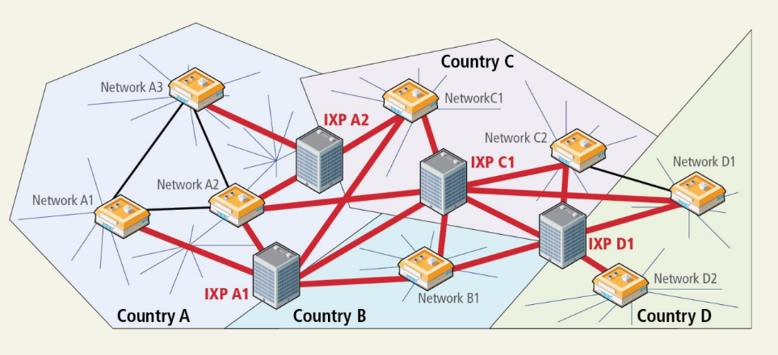

# 1. Index

<!--toc:start-->

- [1. Index](#1-index)
- [2. Funzionamento del Web](#2-funzionamento-del-web)
  - [2.1. **_Principali funzionalità del Web_**](#21-principali-funzionalità-del-web)
  - [2.2. **Vantaggi delle Web App sulle Desktop App**](#22-vantaggi-delle-web-app-sulle-desktop-app)
  - [2.3. **_Intranet_**](#23-intranet)
    - [2.3.1. **Static Web Sites**](#231-static-web-sites)
    - [2.3.2. **Dynamic Web Sites**](#232-dynamic-web-sites)
    - [2.3.3. **WEB 2.0**](#233-web-20)
  - [2.4. **_Four Layer Network Model_**](#24-four-layer-network-model)
    - [2.4.1. **_Link Layer_**](#241-link-layer)
    - [2.4.2. **_Internet Layer_**](#242-internet-layer)
      - [2.4.2.1. **NAT**](#2421-nat)
    - [2.4.3. **_Transport Layer_**](#243-transport-layer)
    - [2.4.4. **_Application Layer_**](#244-application-layer)
- [3. **_Modello Client-Server_**](#3-modello-client-server)
  - [3.1. **_Tipi di Server_**](#31-tipi-di-server)
- [4. **_Dov'è Internet_**](#4-dovè-internet)
- [5. **_Domain Name System $\to$ `DNS`_**](#5-domain-name-system-to-dns)
  - [5.1. **URL**](#51-url)
    - [5.1.1. _Protocollo_](#511-protocollo)
    - [5.1.2. _Query String_](#512-query-string)
- [6. **_HyperText Tranfer Protocol_**](#6-hypertext-tranfer-protocol)
- [7. **_Web Server_**](#7-web-server)
<!--toc:end-->

# 2. Funzionamento del Web

Il _world-wide-web_ è un'applicazione di **Internet**, come lo sono le _email_, _l'online gaming_, ...

In precedenza le reti erano per la maggiorparte relative a comunicazioni telefoniche, ed erano veri e proprie connessioni fisiche tra le due parti dela connessione, detto **Circuito di Switch**.

Questo circuito presentava delle debolezze:

- Necessità di effettuare il link e mantenerlo per tutta la durata
- Difficoltà ad eseguire più connessioni
- Perdità di banda (si comunicano anche i pacchetti)

Per questi motivi si è passati alle **comunicazioni a pacchetti** tramite **_ARPANET_**.

I messaggi che vengono inviati sono quindi sottodivisi in _pacchetti_ che contengono:

- Mittente
- Destinatario
- "Numero del Pacchetto"
- Informazioni sul messaggio

I singoli pacchetti di un messaggio non compione necessariamente lo stesso percorso, perciò è possibile che i pacchetti arrivino in ordine sparso o che qualche pacchetto venga perso (raro)

In questo modo si ottimizzano i problemi del **circuit switching**:

- Più robusto possibilità di utilizzare più strade per collegare due utenti
- Utilizzo più efficente dei link (non più esclusivi a tutta la durata della comunicazione)

Per promuovere la crescita e l'unificazione delle comunicazioni dei pacchetti, sono state introdotte una serie di protocolli per unificare le reti. Questi è stato possibile tramite i protocolli `TCP/IP` (_Transmission Control Protocol / Internet Protocol_).
La standardizzazione dei meccanismi del Web è oggi operata dalla W3C _World Wide Web Consortium_.

## 2.1. **_Principali funzionalità del Web_**

L'invenzione del WWW è attribuita a _Tim Berners-Lee_ e _Robert Cailliau_ nel 1990 mentre lavoravano al **CERN**

Le principali funzionalità del Web sono:

1. `URL` per identificare univocamente e localizzare una risorsa
2. Protocollo `HTTP` per descrivere come le richieste e le risposte operano
3. Programma software (_web server software_) che risponde alle richieste `HTTP`
4. Linguaggio `HTML` per la pubblicazione di pagine e documenti (oggi HTML3 basato su _quick_ e non su `TCP/IP`)
5. Un programma (**browser**) per eseguire richieste `HTTP` da `URL` e stampare gli `HTML` che riceve

## 2.2. **Vantaggi delle Web App sulle Desktop App**

|                                  PROS                                  |                                                CONS                                                 |
| :------------------------------------------------------------------------------------------------------: | :---------------------------------------------------------------------------------------------------------------------------------: |
|                    Accessibilità da qualsiasi calcolatore che ha accesso ad Internet                     |                                    Necessità di avere a disposizione una connessione ad Internet                                    |
|                                   Utilizzo da diversi _OS_ e _browser_                                   |                                        Problemi relativi alla sicurezza sui dati trasmessi.                                         |
| Più facile da aggiornare, necessita solamente un update lato server, senza necessità di distribuirne uno |                          Problemi di archiviazione lato server, di licenze e l'utilizzo dei dati caricati.                          |
|                   Archiviazione Centralizzata, pochi riguardi sulla memoria degli user                   |                          Problemi con siti che possono essere mostrati in maniera errata su alcuni browser                          |
|                                                                                                          | Accessi limitati da Sistemi Operativi che possono impedire il download o l'accesso di alcuni software (come _Adobe Flash_ su _iOS_) |

## 2.3. **_Intranet_**

L'_intranet_ è un network locale, privato e al quale non è possibile accedere da calcolatori non autorizzati.

Sono tipicamente protetti contro un accesso esterno non autorizzato, tramite _firewall_ o _private IP ranges_.

Proprio perché sono private i motori di ricerca hanno accesso limitato o nullo ai contenuti all'interno di intranet privati.

### 2.3.1. **Static Web Sites**

All'inizio dello sviluppo del Web i siti erano scritti da un _webmaster_ che pubblicava le pagine e le aggiornava periodicamente.
Le competenze necessarie erano basiche, bastava infatti la conoscenza dell'HTML e al massimo la familiarità con la manipolazione di immagini.
Questi siti venivano chiamati **static web pages** che erano identici per ogni utente in qualsiasi momento.

### 2.3.2. **Dynamic Web Sites**

Dopo alcuni anni si è passati alle **dynamic web pages**, che effettuano richieste `PHP` che elabora informazioni su database per produrre pagine `HTML` o persino immagini.
Queste pagine sono potenzialmente diverse per utenti diversi o per chiamate dallo stesso utente in momenti diversi.

### 2.3.3. **WEB 2.0**

Dai primi anni 2010 c'è stata un evoluzione nel web, infatti non è più esclusivamente un websmaster a gestire le pagine web.

Gli utenti hanno guadagnato un esperienza più interattiva.

Gli sviluppatori invece hanno visto cambiare il paradigma:

- La logica della programmazione si sposta più su lato browser rispetto al lato server (che però permane)
- Necessità di conoscere il linguaggio `JavaScript` (`ecmasript`), linguaggio _object-oriented_ che viene interpretato dal browser
- Necessità di apprendere le tecniche di programmazione asincorna

## 2.4. **_Four Layer Network Model_**

I network sono gestiti da una da tutta una serie di protocolli che stabiliscono le regole da utilizzare durante le comunicazioni.

Il protocollo `TCP/IP` nasce come una pila di 4 livelli, oggi diventato tecnicamente di 7 (modello `ISO/OSI`).

### 2.4.1. **_Link Layer_**

E' il livello più basso, è responsabile:

- Della trasmissione fisica tra dispositivi
- Di stabilire link logici

Gestisce:

- Creazione di pacchetti
- Trasmissione e ricezione di pacchetti
- Gestione di errori
- Collisioni
- Condivisione in linea

### 2.4.2. **_Internet Layer_**

Chiamato anche **IP Layer** stabilisce connessioni, _routing_ (**hop** tra _router_) e indirizzamento dei pacchetti.

Utilizza il protocollo degli indirizzi internet (_IP_) per identificare tutte le risorse su Internet.

Per identificare i vari indirizzi IP esistono due tecnologie:

- `IPv4`
- `IPv6`

Gli indirizzi IP sono assegnati dal provider di indirizzi IP (**ISP**).

Nelle reti locali i computer possono condividere un singolo indirizzo IP pubblico tra di loro, tramite il `NAT` (_Network Address Translation_)

#### 2.4.2.1. **NAT**

Il _NAT_ (Network Address Translation) si occupa di assegnare a più dispositivi su una rete locale lo stesso indirizzo IP locale.

Infatti ad una rete viene asseganto un indirizzo IP pubblico (`138.76.29.7`) sulla quale comunicheranno con l'esterno tutti i dispositivi della rete, per identificarli si utilizzera il numero della porta sul quale i pacchetti stanno uscendo.

All'interno della rete viene utilizzato un indirizzo IP comune (`192.168.1.x` oppure `10.0.0.x`).

Il NAT si occupa di compiere questa traduzione:

1. **Host** (`10.0.0.1, 3345`) invia un datagramma a (`128.119.40.186, 80`) {`80` è la porta sulla quale è in ascolto il programma sul WebServer}
2. Il _NAT_ traduce l'_IP_ del sorgente in (`138.76.29.7, 5001`) e aggiorna la sua tabella delle traduzioni associando questo nuovo indirizzo al dispositivo corretto
3. Arriva la risposta indirizzata a (`138.76.29.7, 5001`) che viene tradotta di nuovo dal _NAT_ tramite la tabella in (`10.0.0.1, 3345`), cosicché il router invii la risposta al dispositivo corretto.

### 2.4.3. **_Transport Layer_**

Gestisce i limiti dell'Internet Layer, garantendo l'arrivo dei pacchetti trasmessi in ordine e senza errori.

Per fare ciò utilizza diversi meccanismi, basati su protocollo _TCP_.

I singoli pacchetti vengono _acknowleged_ (_ACK_) dal ricevende che invia un pacchetto _ACK_ al mittente per garantire l'arrivo senza errori del pacchetto.

Se il mittente non ricve alcun ACK per un pacchetto esso viene ritrasmesso finché non viene ricevuto.

Oltre a ciò si occupa anche di:

- Controllo del Flow dei dati, ovvero che i dati inviati da un mittente possano essere gestiti dal destinatatrio
- Controllo delle congestioni dei router intermedi, affinché diminuisca la probabilità di sovraccarico router e perdita pacchetti

### 2.4.4. **_Application Layer_**

Implementa i processi di comunicazione tra applicazioni, ad un livello più alto degli indirizzi IP.

# 3. **_Modello Client-Server_**

E' un modello che può identificare il web.

Il modello consiste di due agenti:

- _Client_: fa richieste e riceve risposte dal server
- _Server_ (attivo 24/7): riceve richieste e fornisce risposte su query adoperate da client che effettuano richieste

Il meccanismo più semplice meccanismo di comunicazione tra le parti è il **request-responce loop**.

Il _client_ inizia una richiesta al server che comunica la risposta, che può includere file _HTML_, immagini o altri dati

Un altro modello alternativo, oggi ormai di basso utilizzo, è il **modello peer-to-peer**.
Quest'altro modello non discrimina client e server, infatti ogni dispositivo è identico e in grado di inviare e ricevere dati con qualsiasi altro.

## 3.1. **_Tipi di Server_**

Nel mondo reale i siti non sono salvati su una singola macchina server, ma piuttosto su molti server diversi.

E' comune archiviare le diverse funzionalità di una web app su tipi di server diversi.

- Email server
- Web Server
- Media Server
- Data Server
- Application Server
- Authentication Server

Inoltre un unico server può trovare difficoltà nel gestire le richieste se si presentano in modo massiccio.

Una strategia può essere quello delle _server farm_, che bilanciano il numero di richieste a diversi server identici (_data mirroring_) affinché nessuno venga sovraccaricato (tramite **load bouncer**).

Le _server farm_, seppur possano influenzare la velocità di comunicazione dei dati, prevengono i rischi di perdita dati e la tolleranza ai guasti del servizio.

Oltre al _data mirroring_ (più server stessi siti) è comune anche avere più siti su uno stesso server (_Web Hosting_).

# 4. **_Dov'è Internet_**

Internet è per la maggiorparte delle persone un concetto astratto, nonostante tutti vi entrino in contatto quotidianamente tramite i dispositivi che utilizziamo in casa.

Il **broadband modem** (_DSL modem_) è un ponte tra i dispositivi di rete all'esterno delle notre case e quelli all'interno.

Questi modem sono spesso forniti dagl i*Internet Service Provider (ISP)*.

Il **wirless router** è la manifestazione più visibile di Internet all'interno delle nostre case.

Nella versione più elementare il **Router** è un dispositivo hardware che trasmette pacchetti di data da un network ad un altro, attraverso un processo chiamato per l'appunto _routing_, che consiste in una serie di salti (_hop_) dei dati tra i router.

Per determinare il porssimo _hop di routing_ ogni router utilizza una sua **routing table** che viene constantemente aggiornata e permette ad un router di capire il prossimo step dove inviare il pacchetto per fargli raggiungere la sua destinazione.

Il _routing_ è relativamente semplice quando si tratta di un unico network, tuttavia nella realtà spesso non è così.

Le informazioni possono essere salvate infatti su server anche a 5/6 **autonomous system network** (in Italia $\to$ `GARR`) di distanza, ed è necessario trovare un modo per attraversare i diversi network indipendenti.

Per fare ciò esistono dei punti fisici chiamati **Internet Exchange Points** (`IX` o `IXP`), che non sono altro che strutture dotate da una rete locale che permette lo scambio tra _autonomous system_ diversi.

Gli **IXP** non sono collegati esclusivamente agli **autonomous system network**, bensì anche ai grandi servizi web, come Google e FaceBook.

Facendo così questi servizi migliorano la performance dei propri siti, avvicinando fisicamente all'utente la posizione della locazione del sito (_data mirroring_), diminuendo di fatto la _latenza_.

<figure class="75">

<figcaption>

Di fatti la connessione mondiale è strutturata attraverso un gran numero di connessioni in fibra ottica passanti sott'acqua.

</figcaption>
</figure>

---

# 5. **_Domain Name System $\to$ `DNS`_**

Il `DNS` è un servizio che permette di passare dagli indirizzi `IP` (difficili da ricordare) a indirizzi formati da una stringa.

Quando viene richiesto un indirizzo web, esso lo traduce tramite una tabella in un indirizzo IP, che sarà l'oggetto della richiesta di dati.
In realtà i passaggi sono un po' più complicati, infatti prima di fare la richiesta al _server DNS_, viene fatta prima al **DNS Resolver**, che si trova all'interno della chache del browser.
In caso non venga trovato si fa la richiesta al _DNS Server_, che anch'esso potrebbe non averlo salvato.
In quest'ultimo caso la richiesta è reindirizzata al _Root Name Server_, che restituirà finalmente la risposta.
Per comodità da adesso in poi la risposta verrà salvata nel _DNS Server_.

I nomi simbolici sono organizzati da una gerarchia, ovvero parti separati da punti. L'ordina va a aumentare la specificità allo spostarsi a dx.

<table align="center" frame="void" width="100%">
    <tr align="center">
        <td colspan="4" >
            <i>
                server1.www.websiteexample.com
            </i>
        </td>
    </tr>
    <tr align="center">
        <td width="25%"><i style="color: #FF3333">com</i>: Top-Level Domain <b>TLD</b></td>
        <td width="25%"><i style="color: #2665F5">websiteexample</i>: Second-Level Domain <b>SLD</b></td>
        <td width="25%"><i style="color: #33FFFF">www</i>: Third-Level Domain</td>
        <td width="25%"><i style="color: #FF33FF">server</i>: Fourth-Level Domain</td>
    </tr>
</table>

I **TDL** sono così divisi:

<table align="center">
<tr align="center">
        <td colspan="2">
        <b><i>Generic Top-Level Domain</i> (gTLD)</b></td>
        <td width="50%"><b><i>County Code Top-Level Domain</i> (TLD)</b></td>
    </tr>
    <tr align="center">
        <td><u>Unrestricted</u></td>
        <td><u>Sponsored</u></td>
        <td><u>Nomi di domini internazionalizzati</u></td>
    </tr>
    <tr align="center">
        <td>
            <code>.com</code>,
            <code>.net</code>,
            <code>.org</code>,
            <code>.info</code>
        </td>
        <td>
            <code>.gov</code>,
            <code>.mil</code>,
            <code>.edu</code>,
        </td>
        <td>
            <code>.us</code>,
            <code>.ca</code>,
            <code>.uk</code>,
            <code>.it</code>,
            <code>.fr</code>
        </td>
    </tr>
</table>

Per poter assegnare ad un IP un determinato dominio esistono dei _registri per i nomi di dominio_, e sono loro che concedono i nomi di dominio agli indirizzi IP.

## 5.1. **URL**

Per poter effettuare ricerche sul web si utilizza un determinato meccanismo per permettere di richiedere dei file al server, che si chiama **URL** (_Uniform Resource Locator_).

L'URL è diviso in diverse parti:

- <a href="#protocollo">Protocollo</a>
- Dominio
- Path
- <a href="#query-string">Query String</a>
- Frammenti

### 5.1.1. _Protocollo_

I diversi protocolli con il quale accedere ai vari siti sono _case-sensitive_, infatti protocolli diversi eseguono richieste a porte diverse sui _web server_:

- `ftp://` $\rightarrow$ richiesta FTP sulla porta `21`
- `http://` $\rightarrow$ richiesta HTTP sulla porta `80`

Se si volesse fare una richiesta particolare su una porta basta specificarla dopo i `:`

### 5.1.2. _Query String_

Sono un modo per trasmettere informazioni come input.

La query string inizia con il carattere `?`, e i dati sono delimitati dal carattere `&`.

# 6. **_HyperText Tranfer Protocol_**

Il protocollo HTTP stabilisce una connessione TCP sulla <u>`porta 80`</u>.

Il server si trova in attesa su quella porta e la utilizzera per rispondere con codici/immagini/testo.

Le richieste in questo protocoll osi chiamano richieste `GET`.

Queste richieste portano con loro diverse informazioni che dipendono dal tipo di richiesta. Alcune informazioni possono essere:

- **Protocollo**: Indica il protocollo utilizzato
- **Host**: Risorsa richiesta
- **User-agent**: Informazioni del browser tramite il quale è stata fatta la richiesta
- **Accept**: Tipi di file che il browser può accettare
- **Accept-language**: Lingue che il browser accetta
- **Accept-encoding**: Codifiche che il browser può accettare
- **Connetion**: Se mantenere o meno aperta la connessione con il browser
- **Chache-control**: Quanto "fresca" deve essere la risorsa

Le risposte da parte del Server sono fornite in maniera simile:

- **Protocollo**: Indica il protocollo utilizzato
- **Codice**: Rappresenta il codice di uscita (può essere di errore o meno)
  - `1xx`: codici informativi
  - `2xx`: risposte andate buon fine
    - 200 $\to$ OK
  - `3xx`: codici dovuto a redirezioni
    - 301 $\to$ pagina spostata in maniera permanente
    - 304 $\to$ pagina non modificata
    - 307 $\to$ redirezione temporanea della pagina
  - `4xx`: errori lato client
    - 400 $\to$ bad request
    - 404 $\to$ page not found
    - 414 $\to$ richiesta URI troppo lunga
  - `5xx`: errori lato server
    - 500 $\to$ internal server error
- **Date**: Indica quando è stata prodotta la risorsa
- **Server**: Tipo del server
- **Vary**: Se il server accetta o meno la codifica
- **Content Encoding**: Algoritmo di compressione utilizzato
- **Content Length**: Lunghezza in byte della risorsa
- **Connetion**: Se la connessione con il browser rimane aperta o no
- **Content-Type**: Codifica del testo
- **File HTML**

Oggi quando viene richiesto una pagina web, la richiesta non è mai unica.

Il browser invece effettua diverse richieste (possibile controllarle da schermate nel browser):

- `GET` _HTML_
- `GET` _CSS_
- `GET` _.png_
  Solo successivamente la pagina viene fatta visualizzare all'utente.

I protocolli più utilizzati per le richieste HTML sono:

- `GET/HEAD`: Richiedono risorse. (`HEAD` chiede solo le intestazioni)
- `POST`: Invia risorse.
- `PUT`: Sostituire risore.
- `DELETE`: Cancellare risorse.
- `CONNECT`: Se ci sono meccanismi di _proxy_.
- `TRACE`: Utile per debugging, fornisce informazioni sul percorso della richiesta.
- `OPTION`: Fornisce informzioni aggiuntive sulla risorsa o sul server.

# 7. **_Web Server_**

Un _web server_ è un computer che risponde a richieste HTTP.

Indipendente dall'hardware bisogna scegliere una serie di applicazioni che dovranno gestire le richieste.

Esistono dei pacchetti software preesistenti:

- **LAMP**: basato su sistemi _Linux_, consiste in:
  - Apache web server
  - MySQL database
  - PHP scripting language
- **WISA**: basato su sistemi _Windows_
  - IIS Web Server
  - SQL Server Database
  - ASP.NET tecnologie di sviluppo server-side

Noi useremo una versione diversa del **LAMP** chiamato **WAMP**, basato su _Windows_
