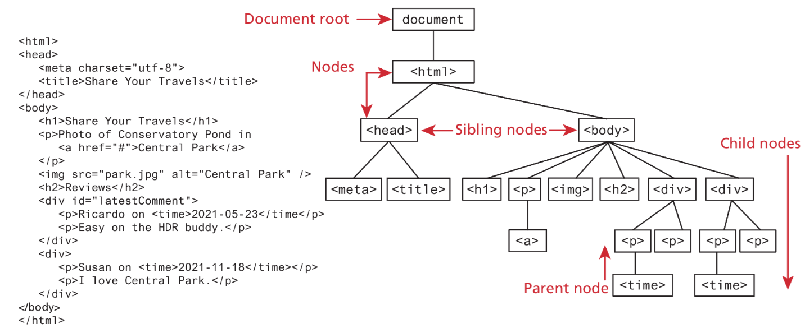
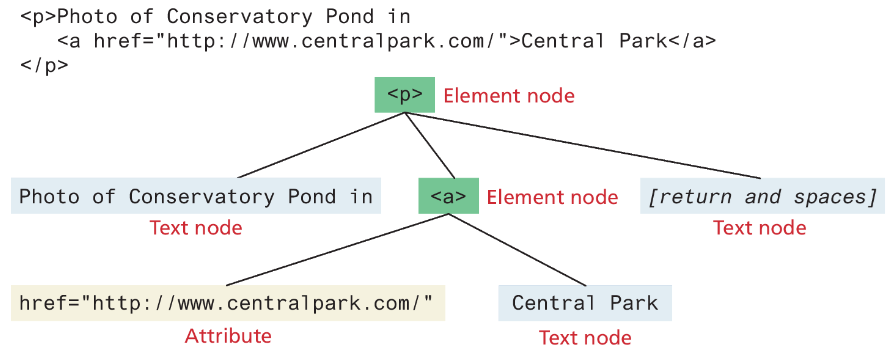

# 1. Index

<!--toc:start-->

- [1. Index](#1-index)
- [2. Javascript a Oggetti](#2-javascript-a-oggetti)
  - [2.1. Oggetti](#21-oggetti)
    - [2.1.1. Funzione Costruttore](#211-funzione-costruttore)
    - [2.1.2. Inheritance](#212-inheritance)
    - [2.1.3. JSON Object](#213-json-object)
    - [2.1.4. Oggetti Built-In](#214-oggetti-built-in)
      - [2.1.4.1. Array](#2141-array)
    - [2.1.5. Boolean](#215-boolean)
    - [2.1.6. Date](#216-date)
    - [2.1.7. Math](#217-math)
    - [2.1.8. Number](#218-number)
    - [2.1.9. String](#219-string)
    - [2.1.10. Regular Expressions](#2110-regular-expressions)
    - [2.1.11. Proprietà Globali e Funzioni](#2111-proprietà-globali-e-funzioni)
  - [2.2. Funzioni](#22-funzioni)
    - [2.2.1. Costruttori](#221-costruttori)
    - [2.2.2. Funzioni Freccia](#222-funzioni-freccia)
    - [2.2.3. Funzioni predefinite](#223-funzioni-predefinite)
  - [2.3. _Regole di Scope_](#23-regole-di-scope)
  - [2.4. **Document Object Model**](#24-document-object-model)
    - [2.4.1. Metodi di Selezione](#241-metodi-di-selezione)
    - [2.4.2. _Metodi di Modifica_](#242-metodi-di-modifica)
    - [2.4.3. _Metodi di Manipolazione_](#243-metodi-di-manipolazione)
    - [2.4.4. _Metodi di Eventi_](#244-metodi-di-eventi)
      - [2.4.4.1. **Tipi di Eventi**](#2441-tipi-di-eventi)
        - [2.4.4.1.1. Eventi Da Mouse](#24411-eventi-da-mouse)
        - [2.4.4.1.2. Eventi da Tatsiera](#24412-eventi-da-tatsiera)
        - [2.4.4.1.3. Eventi Media](#24413-eventi-media)
        - [2.4.4.1.4. Eventi di Frame](#24414-eventi-di-frame)
        - [2.4.4.1.5. Eventi di Form](#24415-eventi-di-form)
        <!--toc:end-->

# 2. Javascript a Oggetti

## 2.1. Oggetti

E' possibile creare degli oggetti in JS.
Si definisce oggetto una collezione di valori nominati (_proprietà_).
In JS gli oggetti <u>non sono creati da classi</u>, anche se nelle ultime versioni di JS quest'ultime sono state introdotte.

Per dichiarare un oggetto:

```js
// Object literal Notation
const objName = {
    name1: value1,
    name2: value2,
    // ...
    nameK: {
        nameK1: valueK1,
        //...
        nameKM: valueKM
        },
    // ...
    nameN: valueN,
    "nome Stringa": valueS
};

console.log(objName.name1);
    // value1
console.log(objName["name1"]);
    // value1
console.log(objName.'nome Stringa');
    // ERRORE
console.log(objName["nome Stringa"]);
    // valueS
```

```js
let { name1, name2 } = objName;
let { nameK1 } = objName.nameK;
// oppure
let {
  name1,
  name2,
  nameK: { nameK1 },
} = objName;

const c1 = 22;
let v1 = "ABC";

const o3 = { c1, v1 };
// oppure
const o3bis = {
  c1: c1,
  v1: v1,
};
```

Un altro modo per creare istanze di oggetti è utilizzando l'_Object Constructor_:

```js
const objName = new Object();

objName.name1 = value1;
objName.name2 = value2;
// ...
objName.nameN = valueN;
```

Le proprietà di un oggetto possono essere generate dinamicamente:

```js
let a = "ABC";
let b = "BCD";
let c = Math.random();
const o6 = {
  [a + b]: "XYZ",
  [c]: Math.random(),
};
console.log(o6);
// {ABCDEF: 'XYZ', '0.32223457423232': 0.7353938477323}

const o7 = new Object();

for (let i = 0; i < 2; ++i) {
  o7["k" + i] = "v" + i;
}

console.log(o7);
// {k0:'v0', k1:'v1', k2:'v2'}
```

Un esempio di oggetto è il seguente:

```js
const nazione1 = {
    nome: "Canada",
    lingue: ["Inglese", "Francese"],
    capitale: {
        nome: "Ottawa",
        locazione: "45'24''N 75'40''W"
    },
    regioni: [
        {nome: "Ontario", capoluogo: "Toronto"}
        {nome: "Manitoba", capoluogo: "Winnipeg"}
        {nome: "Alberta", capoluogo: "Edmonton"}
    ]
}
```

E' inoltre possibile utilizzare la sintassi **spread** per copiare contesti da un array ad un altro.
Ovviamente vengono copiati solo i

```js
const photo = {
    id: 1,
    title: "Central Library",
    location: {
    country: "Canada",
    city: "Calgary"
    }
};

const foo = {name:"Bob", .. .photo.location, iso:"CA" };
// Uguale a
const foo = {name:"Bob", country:"Canada", city: "Calgary", iso:"CA"};
```

Sono copiate i valori dei tipi primitivi e i riferimenti dei tipi riferimento.

Per scorrere tutte le proprietà di un oggetto si possono utilizzare i `for...in`-loops:

```js
const studente = {
  nome: "Mario",
  cognome: "Rossi",
  matricola: 1234,
  voti: [23, 28, 29],
};

// Può anche essere const p, se non varia nel corpo del ciclo
for (let p in studente) {
  console.log(p + " di tipo " + typeof p);
  console.log("con valore di tipo " + typeof studente[p] + ": " + studente[p]);
  console.log("---");

  /* nome di tipo string
   * con valore di tipo string: Mario
   * ---
   * cognome di tipo string
   * con valore di tipo string: Rossi
   * ---
   * matricola di tipo string
   * con valore di tipo number: 1234
   * ---
   * voti di tipo string
   * con valore di tipo object: 23,28,29
   * ---
   */
}
```

### 2.1.1. Funzione Costruttore

E' possibile utilizzare funzioni costruttori.
Queste funzioni definiscono il _type_ dell'oggetto, e vengono invocate tramite la keyword `new`.

```js
function Bike(make, model, year) {
  this.make = make;
  this.model = model;
  this.year = year;
}

function displayBike(bike) {
  for (let a in bike) {
    console.log(a + ":" + bike[a]);
  }
}

let mybike = new Bike("Giant", "Reign", 2013);
let mariobike = new Bike("Specialized", "Enduro", 2018);
let luigibike = new Bike("Transition", "Scout", 2020);
displayBike(mybike);
/*
 * make: "Giant"
 * model: "Reign"
 * year: 2013
 */
displayBike(mariobike);
/*
 * make: "Specialized"
 * model: "Enduro"
 * year: 2018
 */
displayBike(luigibike);
/*
 * make: "Transition"
 * model: "Scout"
 * year: 2020
 */
```

Ovviamente anche con i costruttori è possibile fornire degli oggetti come proprietà di altri oggetti:

```js
function Car(make, model, year, owner) {
  this.make = make;
  this.model = model;
  this.year = year;
  this.owner = owner;
}
function Person(name, age, sex) {
  this.name = name;
  this.age = age;
  this.sex = sex;
}

let owner = new Person("Gino Bianchi", 45, "M");
let mycar = new Car("Fiat", "Topolino", 1956, owner);
let luigicar = new Car("Lancia", "Stratos", 1977);
let mariocar = new Car("Ford", "Model T", 1910);
```

L'operatore `new` consente di creare oggetti _user-defined_ oppure a scelta tra quelli predefiniti: `Array`, `Boolean`, `Date`, `Function`, `Image`, `Number`, `Object`, `Option`, `RegExp`, `String`.

Dato un oggetto è possibile dotarlo di nuove proprietà anche se dichiarato con la funzione costruttrice.
Questa modifica è **esclusiva al singolo oggetto**, non a tutto il tipo.
Per aggiungere a tutti gli oggetti di un dato tipo una proprietà si utilizza il `prototype`.

```js
function Car(ma ke, model, year, owner) {
    this.make = make;
    this.model = model;
    this.year = year;
    this.owner = owner;
}
```

```js
function Person(na me, age, sex) {
    this.name = name;
    this.age =  age;
    this.sex = sex;
}
```

```js
function displayCar(car) {
  for (let a in car)
    if (typeof car[a] == "object")
      for (let i in car[a]) console.log(a + "." + i + ":" + car[a][i]);
    else console.log(a + ":" + car[a]);
}
```

```js
let owner = new Person("Mario Rossi", 45, "M");
let mycar1 = new Car("Eagle", "Talon TSi", 1993, owner);
displayCar(mycar1);
/*
 * make:  ...
 * model: ...
 * year:  ...
 * owner.name: ...
 * owner.age: ...
 * owner.sex: ...
 */
```

```js
Car.prototype.color = "red";
let mycar2 = new Car("Nissan", "300ZX", 1992, owner);
let mycar3 = new Car("Mazda", "Miata", 1990, owner);
mycar3.color = "black ";
displayCar(mycar1);
/*
 * make: ...
 * model: ...
 * year: ...
 * owner.name: ...
 * owner.age: ...
 * owner.sex: ...
 * color: red
 */
```

```js
displayCar(mycar2);
/*
 * make: ...
 * model: ...
 * year: ...
 * owner.name: ...
 * owner.age: ...
 * owner.sex: ...
 * color: red
 */
```

```js
displayCar(mycar3);
/*
 * make: ...
 * model: ...
 * year: ...
 * owner.name: ...
 * owner.age: ...
 * owner.sex: ...
 * color: "black"
 */
```

E' possibile definire anche metodi, passando invece che valori, dei _nomi di funzione_:

```js
function Car(make, model, year, owner) {
  this.make = make;
  this.model = model;
  this.year = year;
  this.owner = owner;
  this.displayCar = displayCar;
}
```

```js
function Person(na me, age, sex) {
    this.name = name;
    this.age =  age;
    this.sex = sex;
}
```

```js
function displayCar(car) {
  for (let a in this)
    if (typeof this[a] == "object")
      for (let i in this[a]) console.log(a + "." + i + ":" + this[a][i]);
    else console.log(a + ":" + this[a]);
}
```

Un altro metodo è quello di fare così:

```js
function Car(make, model, year, owner) {
  this.make = make;
  this.model = model;
  this.year = year;
  this.owner = owner;
}

// Per tutte le macchine
Car.prototype.displayCar = function () {
  for (let a in this)
    if (typeof this[a] == "object")
      for (let i in this[a]) console.log(a + "." + i + ":" + this[a][i]);
    else console.log(a + ":" + this[a]);
};

// Solo per studente2
studente2.migliore = function () {
  let m = 0;
  for (let v of this.voti) {
    if (v > m) m = voti;
  }
  return m;
};
```

### 2.1.2. Inheritance

L'ereditarietà in JS si basa su oggetti prototitpi:

```js
const sopra = {
  proprieta1: 1,
  proprieta2: "XYZ",
};
const sotto = {
  __proto__: sopra,
  proprieta3: 3.14,
};
console.log(sotto);
// {proprieta3: 3.14}
console.log(sotto.proprieta3);
// 3.14
console.log(sotto.proprieta1);
// 1
console.log(sotto.proprieta2);
// XYZ
sotto.proprieta1 = 100;
console.log(sotto);
// {proprieta3: 3.14, proprieta1: 100}
console.log(sopra);
// {proprieta1: 1, proprieta2: 'XYZ'}
```

Gli oggetti possono avere proprietà **proprie** e proprietà **ereditarie**.
Le proprietà ereditarie non sono dell'oggetto, ma vengono associate ad esso.

Sono consultate nel caso in cui nel nostro oggetto non venga trovato un riscontro e sono accessibili **solo in lettura**.
Se infatti proviamo a scrivere su queste proprietà quello che facciamo in realtà è dotare l'oggetto di una nuova proprietà _propria_.

```js
const Persona = {
  stampaGeneralita() {
    console.log(this.nome + " " + this.cognome);
  },
};
const studenteA = {
  __proto__: Persona,
  nome: "Sara",
  cognome: "Verdi",
  media: 23.5,
  stampaStudente() {
    this.stampaGeneralita();
    // Cerca nell'oggetto implicito, trovandola nel prototipo
    console.log("media: " + this.media);
  },
};
const docenteX = {
  __proto__: Persona,
  nome: "Paolo",
  cognome: "Bianchi",
  email: "paolo.bianchi@unipi.it",
  stampaDocente() {
    this.stampaGeneralita();
    // Cerca nell'oggetto implicito, trovandola nel prototipo
    console.log("email: " + this.email);
  },
};
studenteA.stampaStudente();
/*
 * Sara Verdi
 * media: 23.5
 */
docenteX.stampaDocente();
/*
 * Paolo Bianchi
 * email: paolo.bianchi@unipi.it
 */
```

La proprietà `__proto__` solitamente <u>non si setta manualmente</u>.
Le _funzioni costruttori_ ci permettono di creare istanze di classe utilizzando l'operatore `new`.

La funzione setta _automaticamente_ la proprietà **per tutti gli oggetti** affinché ereditino dallo stesso oggetto prototipo.

> In JS due oggetti si dicono _istanze della stessa classe_ se hanno **lo stesso oggetto prototipo**.

```js
function Studente(n, c, m) {
  this.nome = n;
  this.cognome = c;
  this.matricola = m;
  this.voti = [];
}

Studente.prototype.aggiungiVoto = function (v) {
  this.voti[this.voti.length] = v;
};

Studente.prototype.calcolaMedia = function () {
  let s = 0;
  for (let i = 0; i < this.voti.length; i++) s += this.voti[i];
  return s / this.voti.length;
};
```

```js
let s1 = new Studente("Mario", "Rossi", 1234);
s1.aggiungiVoto(20);
s1.aggiungiVoto(22);

let media = s1.calcolaMedia();
console.log(media);

const s2 = new Studente("Sara", "Verdi", 8899);
s2.aggiungiVoto(30);
console.log(s2.calcolaMedia());
```

In realtà la proprietà `__proto__` è l'accessorio di `[[Prototype]]` e la diretta manipolazione di questa propretà è **fortemente sconsigliata**.
Andrebbero utilizzate invece i metodi:

```js
Object.getPrototypeOf(x);
// Ottengo __proto__ di x
Object.setPrototypeOf(x, p);
// Imposto __proto__ di x a p
```

Un esempio è:

```js
const myp = { a: 1, b: 2 };
const mySub = Object.create(myp);
// Creo mySub che ha come prototipo myP
console.log(mySub.a);
// 1

const newProto = { c: 3 };
Object.setPrototypeOf(mySub, newProto);
console.log(mySub.a);
// undefined
console.log(mySub.c);
// 3
```

Ovviamente è possibile avere **più livelli di Inheritance**:

```js
function Poligono(n, l) {
  this.lunghezzaLato = l;
  this.numeroLati = n;
}
function Quadrato(l) {
  Poligono.call(this, 4, l);
}
Object.setPrototypeOf(Quadrato.prototype, Poligono.prototype);

Poligono.prototype.perimetro = function () {
  return this.lunghezzaLato * this.numeroLati;
};

Quadrato.prototype.area = function () {
  return this.lunghezzaLato * this.lunghezzaLato;
};
```

```js
const q = new Quadrato(10);
console.log(q.area());
// 100
console.log(q.perimetro());
// 40
```

### 2.1.3. JSON Object

Il **JavaScript Object Notation** è utilizzato come un linguaggio di scambio dati _language-indipendent_, simile al **XML**.

La differenza principale tra JSON e la _literal object notation_ è che le proprietà dei nomi sono salvate anchesse tra virgolette:

```json
{
    "name1": "value1",
    "name2": "value2",
    //...
    "nameN": "vaueN"
};
```

In JS:

```js
const text = {
  name1: "value1",
  name2: "value2",
  //...
  nameN: "vaueN",
};
// In questo momento text è una stringa

const anObj = JSON.parse(text);
// Adesso è un oggetto
```

JSON è incontrato molto frequenstemente nel contesto di sviluppo web moderno.

### 2.1.4. Oggetti Built-In

Sono degli oggetti predefiniti del linguaggio JS contenenti di _default_ una serie di metodi utili.

#### 2.1.4.1. Array

Gli _Array_ sono un set ordinato di valori riferiti tramite _indice_ non necessariamente omogenei nel contenuto.

Gli _Array_ hanno metodi ereditati per permetteterne la manipolazione in diversi modi (unire, invertire, ordinare).

Tutti gli array hanno la proprietà `lenght` per determinarne la lunghezza.

```js
let v = [10, 20, 30];
console.log(v.length);
// 3
v.length = 6;
console.log(v);
// [ 10, 20, 30, <3 empty items> ]
v[8] = 999;
console.log(v);
// [ 10, 20, 30, <5 empty items>, 999 ]
```

Una lista dei metodi principali per gli array:

<div class="flexbox" markdown="1">

|    Metodo    |                 Argomenti                 |                                                                                                               Descrizione                                                                                                               |
| :----------: | :---------------------------------------: | :-------------------------------------------------------------------------------------------------------------------------------------------------------------------------------------------------------------------------------------: |
|  `concat()`  |           `array2, ..., arrayN`           |                                                                                              Unisce due o più array ritornandone una copia                                                                                              |
|   `join()`   |             `separator (opt)`             |                                                           Unisce tutti gli elementi in una stringa. <br> Se il separatore è omesso gli elemennti sono separati da una virgola                                                           |
|   `pop()`    |                     /                     |                                                                                            Rimuove l'ultimo elemento dell'array ritornandolo                                                                                            |
|   `push()`   |              `el1, ..., elN`              |                                                                               Aggiunge gli elementi alla fine dell'array e restituisce la nuova `lenght`                                                                                |
| `reverse()`  |                     /                     |                                                                                               Inverte l'ordine degli elementi nell'array                                                                                                |
|  `shift()`   |                     /                     |                                                                                           Rimuove il primo elemento di un array ritornandolo                                                                                            |
| `unshift()`  |              `el1, ..., elN`              |                                                                                Aggiunge gli elementi all'inizio dell'array ritornando la nuova `length`                                                                                 |
|  `slice()`   |           `start`, `end (opt)`            |                                   Selezione parte di un array e la ritorna come nuovo array.<br>`start` può essere negativo (fine dell'array).<br>Se `end` è omesso arriva fino alla fine dell'array                                    |
|   `sort()`   |              `sortFun (opt)`              |                                                                  Ordina gli elementi con la funzione inserita.<br>Se omessa ordina in ordine **alfabetico crescente**                                                                   |
|  `splice()`  | `index`, `howmany`, `el1, ..., elN (opt)` | Aggiunge/Rimuove elementi.<br>`index` specifica la posizione dove aggiungere/rimuovere.<br>`howmany` specifica il numeri degli elementi da rimuovere (0 $\rightarrow$ nessuno).<br>`el1, ..., elN` gli elementi da aggiungere all'array |
| `toString()` |                     /                     |                                                                                            Converte l'array in una stringa e la restituisce                                                                                             |
| `valueOf()`  |                     /                     |                                                                                                 Converte i valori primitivi dell'array                                                                                                  |

</div>

Per quanto riguarda la `sort(sortFun)`, la funzione `sortFun(a, b)` deve avere come ritorno un valore che può essere:

- `< 0` $\rightarrow$ `a` prima di `b`
- `= 0` $\rightarrow$ Non cambio nulla
- `> 0` $\rightarrow$ `b` prima di `a`

### 2.1.5. Boolean

I _Boolean_ sono utilizzati in due modi:

- `new Boolean(v)`: crea un _wrapper boolean object_, non un tipo primtivo
- `Boolean(v)`: converte `v` in un tipo primitivo _Boolean_ (più comune)

```js
// Alcuni oggetti wrapper
const b1 = new Boolean(0);
const b2 = new Boolean(null);
const b3 = new Boolean(false);
const b4 = new Boolean("ABC");
const b5 = new Boolean(39);

/*
 * valueOf():
 *   Restituisce il valore del tipo primitivo
 *   (true/false) dall'oggetto wrapper
 */
console.log(b1.valueOf());
// false
console.log(b2.valueOf());
// false
console.log(b3.valueOf());
// false
console.log(b4.valueOf());
// true
console.log(b5.valueOf());
// true

// b1, ..., b5 sono tutti tipi object
console.log(typeof b1);
// object

// Un valore non-null è considerato true, anche
// se è un Boolean con contenuto false
if (b3) console.log("Sono entrato");
else console.log("Sono nell'else");

// Sono entrato

// Ora il suo valore
if (b3.valueOf()) console.log("Sono entrato");
else console.log("Sono nell'else");

// Sono nell'else
```

Alcune regole di conversione in `Boolean`:

```js
const cb1 = Boolean(undefined);
// false
const cb2 = Boolean(null);
// false
const cb3 = Boolean(0);
// false
const cb4 = Boolean([]);
// true
const cb5 = Boolean("");
// false
const cb6 = Boolean({ a: 1 });
// true
const cb7 = Boolean([1, 2, 3]);
// true
const cb8 = Boolean("ABC");
// true
const cb9 = Boolean(new Boolean(false));
// true
```

Esistono due categorie di valori:

- _Truthy_: valori convertiti in `true`
- _Flasy_: valori convertiti in `false`

```js
/*
 * Un array vuoto è truthy
 * Questo perché tutti gli oggetti sono truthy
 * E un array vuoto è pur sempre un array
 */
let a = [];
if (a) {
  console.log("Sono dentro 1!");
} else {
  console.log("Nope 1");
}

/*
 * Tuttavia equivale in maniera larga a false.
 * Questo è dovuto alle multiple conversioni implicite:
 *   - a è convertito in un tipo primitivo stringa usando Array.prototype.toString()
 *   - Il risultto è quindi ""
 *   - Per comparare string e bool si convertono entrambi in numeri e valgono entrambi 0
 *
 * Perciò mentre a è truthy, è vero anche che a == false
 */
if (a == false) {
  console.log("Sono dentro 2!");
} else {
  console.log("Nope 2");
}

/* Output:
 *       Sono dentro 1!
 *       Sono dentro 2!
 */
```

### 2.1.6. Date

Il JS salva le date come il **numero di millisecondi** a partire dal `01-01-1970,00:00:00` chiamata di seguito _default_.

Esistono quattro modi per creare un oggetto `Date`:

- `new Date()`: crea un oggetto con la data e il tempo attuale
- `new Date(milliseconds)`: crea un oggetto contenente i _millisecondi_ dalla partenza
- `new Date(dateString)`: una stringa nel seguente formato: `Month Day, Year HH:MM:SS`
  - `xmas23 = new Date("December 25, 2023 19:15:00")`
  - Se si omettono `HH`, `MM` o `SS` saranno impostati di default a 0
- `new Date(year, month, day, h, min, s, ms)`: tutti i parametri devono essere **valori interi**

Alcuni metodi utili sono i seguenti:

<div class="flexbox" markdown="1">

|          Metodo          | Descrizione                                                                                               | Range Ritorno             |
| :----------------------: | :-------------------------------------------------------------------------------------------------------- | :------------------------ | -------- |
|       `getDate()`        | Ritorna il giorno del mese                                                                                | $1\to31$                  |
|       `getTime()`        | Ritorna Il numero di millisecondi dal _default_                                                           | $0 \to 2^{32}-1$          |
|        `getDay()`        | Ritorna il giorno della settimana                                                                         | $0\to6$                   |
|     `getFullYear()`      | Ritorna l'anno                                                                                            | $0000\to9999$             |
|       `getMonth()`       | Ritorna il mese                                                                                           | $0\to11$                  |
|       `getHours()`       | Ritorna l'ora                                                                                             | $0\to23$                  |
|      `getMinutes()`      | Ritorna i minuti                                                                                          | $0\to59$                  |
|      `getSeconds()`      | Ritorna i secondi                                                                                         | $0\to59$                  |
|   `getMilliseconds()`    | Ritorna i millisecondi                                                                                    | $0\to999$                 |
| `Date.parse(datestring)` | Elabora una stringa e restituisce il numero di millisecondi a partire dal _default_                       | $0 \to 2^{32}-1$          |
|       `setDate()`        | Imposta il giorno del mese                                                                                |                           | $1\to31$ |
|     `setFullYear()`      | Imposta l'anno                                                                                            | $0000\to9999$             |
|       `setMonth()`       | Imposta il mese                                                                                           | $0\to11$                  |
|       `setHours()`       | Imposta l'ora                                                                                             | $0\to23$                  |
|      `setMinutes()`      | Imposta i minuti                                                                                          | $0\to59$                  |
|      `setSeconds()`      | Imposta i secondi                                                                                         | $0\to59$                  |
|       `setMonth()`       | Imposta i millisecondi                                                                                    | $0\to999$                 |
|      `setTime(ms)`       | Imposta un `datetime` aggiungendo o sottraendo `ms` dal numero di millisecondi dal _default_              | `Month DD, YYYY HH:MM:SS` |
|     `toDateString()`     | Converte la porzione `date` in una stringa                                                                | -                         |
|  `toLocaleDateString()`  | Converte la porzione `date` in una stringa, utilizzando le convenzioni locali                             | -                         |
|       `toString()`       | Converte il `datetime` in una stringa                                                                     | -                         |
|    `toLocaleString()`    | Converte il `datetime` in una stringa, utilizzando le convenzioni locali                                  | -                         |
|     `toTimeString()`     | Converte la porzione `time` in una stringa                                                                | -                         |
|  `toLocaleTimeString()`  | Converte la porzione `time` in una stringa, utilizzando le convenzioni locali                             | -                         |
|         `UTC()`          | Ritorna il numero di millisecondi dal `default` in una stringa in accordo all'_Universal Time Convention_ | $0\to2^{32} - 1$          |
|     `toUTCString()`      | Ritorna il `datetime` in una stringa in accordo all'_Universal Time Convention_                           | -                         |
|       `valueOf()`        | Ritorna il valore primitivo di un `Date` object                                                           |                           |

</div>

```js
let d = new Date();
console.log("Original form: " + d);
// Mon Nov 11 2024 14:20:59 GMT+0100 (Ora standard dell'Europa centrale)
console.log("Formatted form: " + d.toLocaleDateString());
// 11/11/2024
```

### 2.1.7. Math

L'oggetto `Math` permette di effettuare operazioni matematiche, includendo diverse costanti e metodi matematici.

`Math` non è un costruttore, e non possono essere creati oggetti `Math`.
Se si vogliono utilizzare delle proprietà/metodi va richiamato l'oggetto stesso.

```js
let piGreco = Math.PI;
let radiceQ = Math.sqrt(16);
```

<div class="flexbox" markdown="1">

|       Metodo       | Descrizione                                                                            |
| :----------------: | :------------------------------------------------------------------------------------- |
|        `E`         | Restituisce il numero di Eulero $e$                                                    |
|       `LN2`        | Restituisce il logaritmo naturale di $2$                                               |
|       `LN10`       | Restituisce il logaritmo naturale di $10$                                              |
|      `LOG2E`       | Restituisce il logaritmo in base 2 di $e$                                              |
|      `LOG10E`      | Restituisce il logaritmo in base 10 di $e$                                             |
|        `PI`        | Restituisce $\pi$                                                                      |
|     `SQRT1_2`      | Restituisce la radice quadrata di $\frac{1}{2}$                                        |
|      `SQRT2`       | Restituisce la radice quadrata di $2$                                                  |
|      `abs(x)`      | Restituisce il valore assoluto di $x$                                                  |
|      `cos(x)`      | Restituisce $\cos(x)$ con $x$ in radianti                                              |
|      `sin(x)`      | Restituisce $\sin(x)$ in radianti                                                      |
|      `tan(x)`      | Restituisce $\tan(x)$                                                                  |
|     `acos(x)`      | Restituisce $\arccos{x}$ in radianti                                                   |
|     `asin(x)`      | Restituisce $\arcsin{x}$ in radianti                                                   |
|     `atan(x)`      | Restituisce $\arctan{x}$ come valore $-\frac{\pi}{2} \le n \le \frac{\pi}{2}$ radianti |
|    `atan2(y,x)`    | Restituisce l'arcotangente del quoziente dei suoi argomenti                            |
|     `pow(x,y)`     | Restituisce il valore di $x^y$                                                         |
|     `sqrt(x)`      | Restituisce il valore di $\sqrt{x}$                                                    |
|      `exp(x)`      | Restituisce il valore di $e^x$                                                         |
|      `log(x)`      | Restituisce il valore $\ln{x}$                                                         |
| `max(x,y,z,...,n)` | Restituisce il numero con il valore più alto                                           |
| `min(x,y,z,...,n)` | Restituisce il numero con il valore più basso                                          |
|     `round(x)`     | Arrotonda $x$ al numero intero più vicino                                              |
|     `ceil(x)`      | Restituisce $\lceil x \rceil$                                                          |
|     `floor(x)`     | Restituisce $\lfloor x\rfloor$                                                         |
|     `random()`     | Restituisce un numero casuale $0 \le x < 1$                                            |

</div>

### 2.1.8. Number

E' utilizzato in due modi:

- `new Number(v)`: Crea un _wrapper object_ di valore `v`, non è un valore primitivo
- `Number(v)`: Converte `v` in un valore primitivo (**più comune**)

L'oggetto `Number` ha delle proprietà riguardanti le **costanti numeriche**:

<div class="flexbox" markdown="1">

|      Proprietà      | Descrizione                                                 |
| :-----------------: | :---------------------------------------------------------- |
|     `MAX_VALUE`     | Restituisce **il più grande numero** rappresentabile in JS  |
|     `MIN_VALUE`     | Restituisce **il più piccolo numero** rappresentabile in JS |
| `NEGATIVE_INFINITY` | Rappresenta il valore $\infty$, ottenuto negli _overflow_   |
| `POSITIVE_INFINITY` | Rappresenta il valore $-\infty$, ottenuto negli _overflow_  |

</div>

Alcuni metodi utili:

<div class="flexbox" markdown="1">

|       Metodo       | Descrizione                                               | Argomenti                                                                                                               |
| :----------------: | :-------------------------------------------------------- | :---------------------------------------------------------------------------------------------------------------------- |
| `toExponential(x)` | Converte un numero nella notazione esponenziale           | `x`: opzionale, è un intero tra 0 e 20 che rappresenta il numero di cifre dopo la virgola, _default_: minimo necessario |
|    `toFixed(x)`    | Formatta un numero decimale con `x` cifre dopo la virgola | `x`: opzionale, _default_: 0                                                                                            |
|  `toPrecision(x)`  | Formatta un numero alla lunghezza `x`                     | `x`: opzionale, _default_: restituisce il numero stesso                                                                 |
|    `toString()`    | Converte l'oggetto `Number` in una stringa                | /                                                                                                                       |
|    `valueOf()`     | Restituisce il valore primitivo di un oggetto `Number`    | /                                                                                                                       |
|  `parseInt(str)`   | Restituisce un intero a partire dalla stringa `str`       | `str`: stringa contenente un numero                                                                                     |
| `parseFloat(str)`  | Restituisce un float a partire dalla stringa `str`        | `str`: stringa contenente un numero                                                                                     |

</div>

```js
let num = new Number(13.3714);
console.log(Number.MAX_VALUE);
// 1.7976931348623157e+308
console.log(Number.MIN_VALUE);
// 5e-324
console.log(num.toExponential(4));
// 1.3371e+1
console.log(num.toFixed(2));
// 13.37
console.log(num.toPrecision(3));
// 13.4
console.log(num.toString());
// "13.3714"
console.log(num.valueOf());
// 13.3714
```

Le conversioni implicite seguono le seguenti regole:

```js
const n1 = Number("ABC");
// NaN
const n2 = Number("123");
// 123
const n3 = Number("");
// 0
const n4 = Number([]);
// 0
const n5 = Number([33]);
// 33
const n6 = Number([33, 44]);
// NaN
const n7 = Number(undefined);
// NaN
const n8 = Number(null);
// 0
const n9 = Number(true);
// 1
const n10 = Number(false);
// 0
const n11 = Number({
  valore: 4,
  valueOf() {
    return this.valore;
  },
});
// 4
```

### 2.1.9. String

L'oggetto `String` è un _wrapper_ del tipo primitivo, e viene creato con l'operatore `new`.

```js
let s1 = "Hi";
// Stringa
let s2 = new String("Hi");
// String Object
```

Le conversioni implicite sono così gestite:

```js
const o = {
  valore: 4,
  toString() {
    return "pippo";
  },
  valueOf() {
    return this.valore;
  },
};

const s1 = String(undefined);
// "undefined"
const s2 = String(null);
// "null"
const s3 = String(1234);
// "1234"
const s4 = String(true);
// "true"
const s5 = String(o);
// "pippo"
const s6 = "" + o;
// "4"
```

Come per tutti gli altri oggetti anche `String` ha una serie di metodi utili:

<div class="flexbox" markdown="1">

|      Metodo       | Descrizione                                 | Argomenti |
| :---------------: | :------------------------------------------ | :-------- |
|    `charAt()`     | Ritorna il carattere all'indice specificato |           |
|        ``         |                                             |           |
|        ``         |                                             |           |
|        ``         |                                             |           |
|        ``         |                                             |           |
|        ``         |                                             |           |
| `substring(x, y)` | (**Deprecato**) Estrai i caratteri da       | /         |
|        ``         |                                             | /         |
|        ``         |                                             | /         |
|    `valueOf()`    | Restituisce il valore dello `String` object | /         |

</div>

```js
let str = "Hello world!";
console.log(str);
// "Hello world!"
console.log(str.substring(1));
// "ello world!"
console.log(str.substring(3, 7));
// "lo wo";
console.log(str.split("o", 2));
// "Hell", "W"
console.log(str.toUpperCase());
// "HELLO WORLD!"
console.log(str.toLowerCase());
// "hello world!"
```

### 2.1.10. Regular Expressions

Una _regular expression_ è un set di caratteri speciale che definisce un pattern.

Un espressione regolare consiste in due tipi di caratteri:

- **Letterale**: carattere che vogliamo matchare nell'obiettivo
- **Metacarattere**: simbolo speciale che agisce come un comando per l'_expression parser_ . Ne esistono 14: `.[]\()^$|*?{}+`

In JS le _regular expression_ sono _case sensitive_ e contenuti tra slash `/ /`, per esempio:

```js
let pattern = /ran/;
```

Avrà un match in tutte e tre le stringhe:

> randy connolly
> Sue ran to the store
> I would like a cranberry

Sono potenti per fare _patter-match_ e _search-and-replace_ nelle funzioni o nei testi:

```js
let txt = /pattern/modifiers;
    // pattern: il pattern di un espressione
    // modifiers: specifica se la search deve essere global, case-sensitive, ...
```

I modificatori più usati sono:

- `i`: Matching _case-insensitive_
- `g`: Marching _globale_, non ci si ferma al primo match

Per quanto riguarda i metodi invece:

- `exec(str)`: Restituisce il primo match
- `test(str)`: Effettua una ricerca nella stringa. Restituisce `true`/`false`

Le espressioni più comuni sono:

<div class="flexbox" markdown="1">

|     Espressione      | Descrizione                                                                  |
| :------------------: | :--------------------------------------------------------------------------- |
|       `[abc]`        | Trova qualsiasi carattere tra le parentesi quadre                            |
|       `[^abc]`       | Trova qualsiasi carattere non tra le parentesi quadre                        |
|       `[0-9]`        | Trova qualsiasi cifra $0 \to 9$                                              |
|       `[a-z]`        | Trova qualsiasi carattere dalla lettera minuscola a alla lettera minuscola z |
|       `[A-Z]`        | Trova qualsiasi carattere dalla lettera maiuscola A alla lettera maiuscola Z |
|       `[a-Z]`        | Trova qualsiasi carattere dalla lettera minuscola a alla lettera maiuscola Z |
|        `adgk`        | Trova la sequenza di caratteri specificata                                   |
| `(red\|blue\|green)` | Trova una qualsiasi delle alternative specificate                            |

</div>

I _metacaratteri_ più utilizzati sono invece:

<div class="flexbox" markdown="1">

| Metacarattere | Descrizione                                                            |
| :-----------: | :--------------------------------------------------------------------- |
|      `.`      | Trova un singolo carattere, tranne newline o terminatore di riga       |
|     `\w`      | Trova un carattere alfanumerico                                        |
|     `\W`      | Trova un carattere non alfanumerico                                    |
|     `\d`      | Trova una cifra                                                        |
|     `\D`      | Trova un carattere non cifra                                           |
|     `\s`      | Trova un carattere di spazio bianco                                    |
|     `\S`      | Trova un carattere non di spazio bianco                                |
|     `\b`      | Trova una corrispondenza all'inizio/fine di una parola                 |
|     `\B`      | Trova una corrispondenza non all'inizio/fine di una parola             |
|     `\0`      | Trova un carattere `NUL`                                               |
|     `\n`      | Trova un carattere di nuova riga                                       |
|     `\f`      | Trova un carattere di avanzamento pagina                               |
|     `\r`      | Trova un carattere di ritorno a capo                                   |
|     `\t`      | Trova un carattere di tabulazione                                      |
|     `\v`      | Trova un carattere di tabulazione verticale                            |
|    `\xxx`     | Trova il carattere specificato da un numero ottale `0xxx`              |
|    `\xdd`     | Trova il carattere specificato da un numero esadecimale `0xdd`         |
|   `\uxxxx`    | Trova il carattere Unicode specificato da un numero esadecimale `xxxx` |

</div>

Sono presenti anche dei _quantificatori_. Essi ci permettono di dire quanti match sono necessari per ottenere un **match valido**

<div class="flexbox" markdown="1">

| Quantificatore | Descrizione                                                                                  |
| :------------: | :------------------------------------------------------------------------------------------- |
|      `n+`      | Corrisponde a qualsiasi stringa che **contiene almeno un** `n`                               |
|      `n*`      | Corrisponde a qualsiasi stringa che **contiene zero o più occorrenze di** `n`                |
|      `n?`      | Corrisponde a qualsiasi stringa che **contiene zero o una occorrenza di** `n`                |
|     `n{X}`     | Corrisponde a qualsiasi stringa che contiene **una sequenza di X** `n`                       |
|    `n{X,Y}`    | Corrisponde a qualsiasi stringa che contiene **una sequenza di almeno X e non più di Y** `n` |
|    `n{X,}`     | Corrisponde a qualsiasi stringa che contiene **una sequenza di almeno X** `n`                |
|      `n$`      | Corrisponde a qualsiasi stringa con `n` **alla fine**                                        |
|      `^n`      | Corrisponde a qualsiasi stringa con `n` **all'inizio**                                       |
|     `?=n`      | Corrisponde a qualsiasi stringa che **è seguita da una specifica stringa** `n`               |
|     `?!n`      | Corrisponde a qualsiasi stringa che **non è seguita da una specifica stringa** `n`           |

</div>

```js
let s1 = "10, 200, 2000, 10000 or 3000000?";
let p1 = /\d{3,4}/g;
// tutte le occorrenze tra 3 e 4 cifre decimali

let v1 = s1.match(p1);
console.log(v1);
// 200, 2000, 1000, 3000, 000

let s2 =
  "Lorem ipsum dolor sit amet, consectetur adipiscing elit, sed do eiusmod tempor incididunt ut labore et dolore a magna aliqua.";
let p2 = /[abc]\w+/g;
/*
 * tutte le sottostringhe dove:
 *   - a,b o c è il primo carattere e
 *   - Le altre sono almeno 1 o più lettere
 */
let v2 = s2.match(p2);
console.log(v2);
// amet, consectetur, adipiscing, cididunt, abore, bore, aliqua
```

### 2.1.11. Proprietà Globali e Funzioni

Il JS implementa delle proprietà globali e delle funzione che possono essere utilizzate con tutti gli oggetti _built-in_.

Tra le proprietà troviamo:

<div class="flexbox" markdown="1">

|  Proprietà  | Descrizione                                      |
| :---------: | :----------------------------------------------- |
| `Infinity`  | Valore numerico che rappresenta $\plusmn \infty$ |
|    `NaN`    | _Not-a-Number_                                   |
| `undefined` | La variabile non ha un valore assegnato          |

</div>

Tra le funzioni invece abbiamo:

<div class="flexbox" markdown="1">

|        Funzione        | Descrizione                                                                                                                                                                                                                                               |
| :--------------------: | :-------------------------------------------------------------------------------------------------------------------------------------------------------------------------------------------------------------------------------------------------------- |
|     `decodeURI()`      | Decodifica un URI                                                                                                                                                                                                                                         |
| `decodeURIComponent()` | Decodifica una componente URI                                                                                                                                                                                                                             |
|     `encodeURI()`      | Codifica un URI                                                                                                                                                                                                                                           |
| `encodeURIComponent()` | Codifica una componente URI                                                                                                                                                                                                                               |
|        `eval()`        | Valuta una stringa ed esegue il codice come se fosse un codice script. <br> Prima, `eval()` determina se l'argomento è una stringa valida, quindi analizza la stringa alla ricerca di codice JavaScript. <br> Se trova codice JavaScript, verrà eseguito. |
|      `isFinite()`      | Determina se un valore è un numero legale finito.                                                                                                                                                                                                         |
|       `isNaN()`        | Determina se un valore è un numero illegale.                                                                                                                                                                                                              |
|     `parseFloat()`     | Analizza una stringa e restituisce un numero in virgola mobile.                                                                                                                                                                                           |
|      `parseInt()`      | Analizza una stringa e restituisce un numero intero.                                                                                                                                                                                                      |

</div>

```js
eval("x=10;y=20;console.log(x*y)");
// 200
console.log(eval("2+2"));
// 4
console.log(eval(x + 17));
// 27
```

## 2.2. Funzioni

Le funzioni sono definite utilizzando la _keyword_ `function`.

Le funzioni in JS non richiedono un ritorno né che i tipi dei parametri vengano specificati.

```js
function subtotal(price, quantity) {
  return price * quantity;
}

let result = subtotal(10, 2);
```

Le espressioni funzione sono delle _funzioni anonime_ che possono essere assegnate a variabili o costanti:

```js
const calculateSubtotal = function (price, quantity) {
  return price * quantity;
};

let result = calculateSubtotal(10, 2);

const warn = function (msg) {
  alert(msg);
};

warn("Non ho ritorno!");
```

Le funzioni possono assegnare valori di default ai loro parametri se la chiamata non lo facesse.
Il valore di default utilizzato è `NaN`, ma è possibile specificarlo:

```js
function foo(a, b) {
  return a + b;
}

let bar = foo(3); // 3 + NaN = NaN

function fof(a = 10, b = 0) {
  return a + b;
}

let bar = fof(3); // 3 + 0 = 3
```

E' possibile scrivere funzioni che possono prendere in input un _numero variabile di parametri_, grazie all'**operatore di rilassamento** `...`.
Tutti gli argomenti di una funzione sono conservati nell'array `arguments` di ogni funzione. E' quindi possibile accedervi tramite `arguments[i]` oppure `functionName.arguments[i]`.

```js
function concatena(...args) {
  let s = "";
  for (let a of args) {
    s += a + " ";
  }
  return s;
}

let girls = concatena("fatima", "hema", "jane", "alilah");
let boys = concatena("jamal", "nasir");
```

```js
function myConcat(separator) {
  let result = "";

  // Necessariamente 1, l'elemento 0 è separator
  for (let i = 1; i < arguments.length; i++) {
    result += arguments[i] + separator;
  }
  return result;
}

console.log(myConcat(", ", "red", "orange", "blue"));
// "red, orange, blue, "
console.log(myConcat("; ", "elephant", "giraffe", "lion", "cheetah"));
// "elephant; giraffe; lion; cheetah;"
console.log(myConcat(". ", "sage", "basil", "oregano", "pepper", "parsley"));
// "sage. basil.  oregano. pepper. parsley. "
```

E' possibile annidare funzioni, andando a dichiarare funzioni all'interno di altre funzioni.
Se la dichiarazione è _anonima_, essa <u>va inserita in cima al blocco della funzione</u>, negli altri casi tutto funziona regolarmente:

```js
function calculateTotal(price, quantity) {
  let subtotal = price * quantity;
  return subtotal + calculateTax(subtotal);
  // this function is nested
  function calculateTax(subtotal) {
    let taxRate = 0.05;
    return subtotal * taxRate;
  }
}
```

Poiché le funzioni in JS sono oggetti, è possibile passare una funzione come argomento di un'altra funzione.
Questo processo si chiama funzione **callback**.
Ed è persino possibile **definire una funzione direttamente nei parametri**.

```js
const calculateTotal = function (price, quantity, tax) {
  let subtotal = price * quantity;
  return subtotal + tax(subtotal);
};

const calcTax = function (subtotal) {
  let taxRate = 0.05;
  let tax = subtotal * taxRate;
  return tax;
};

let temp = calculateTotal(50, 2, calcTax);
// Passo la funzione calcTax come se fosse un oggetto
// Affinché la funzione la utilizzi

// /------ oppure ------/

let temp = calculateTotal(50, 2, function (subtotal) {
  let taxRate = 0.05;
  let tax = subtotal * taxRate;
  return tax;
});
```

In JS gli oggetti hanno come proprietà funzioni.
Esiste anche in JS la keyword `this`, che riferisce l'ambiente nel quale si trova.

```js
const order = {
  salesDate: "May 5, 2016",
  product: {
    price: 500.0,
    brand: "Acer",
    output: function () {
      return this.brand + " $" + this.price;
      // this -> order.product
    },
  },
  customer: {
    name: "Sue Smith",
    address: "123 Somewhere St",
    output: function () {
      return this.name + ", " + this.address;
      // this -> order.customer
    },
  },
};
```

Da notare come la keyword `this` assuma un ruolo diverso a seconda del contesto nella quale è inserita.

### 2.2.1. Costruttori

Le funzioni in JS possono avere dei costruttori.
L'approccio è simile a quello del Java e del C++, tuttavia la differenza è in come funziona la `new`.

```js
// function constructor
function Customer(name, address, city) {
  this.name = name;
  this.address = address;
  this.city = city;
  this.output = function () {
    return this.name + " " + this.address + " " + this.city;
  };
}

const cust1 = new Customer("Sue", "123 Somewhere", "Calgary");

const cust2 = new Customer("Fred", "32 Nowhere St", "Seattle");
```

Inizialmente viene creato un nuovo **oggetto vuoto**.
Scorrendo le righe di codice nella funzione vengono introdotte una alla volta.

### 2.2.2. Funzioni Freccia

Le funzioni freccia permettono di minimizzare la sintassi per la definizione di funzioni anonime.

```js
const taxRate = function() {retrun 0.05;};

// versione freccia

const taxRate = () => 0.05;
```

Alcuni equivalenti:

```js
function () {
    //statement
}

() => {
    //statement
}

```

```js
function(){
    return value;
}

() => value;

```

```js
function (a, b) {
    //statement
}

(a, b) => {
    //statement
}

```

```js
function(a, b){
    return value;
}

(a, b) => value;

```

```js
function () {
    doSomething();
}

() => {
    doSomething();
}

```

```js
function (a) {
    return value;
}

(a) => return value
a => value;

```

```js
const g = function (a) {
  return value;
};

const g = (a) => value;
```

```js
function (a,b) {
    return {
        p1: a,
        p2: b
    }
}

(a, b) => ({
            p1: a,
            p2: b
            })
```

All'interno delle _arrow function_ `this` assume un ruolo più simile a quello che ha in lunguaggi come Java o C++.
Infatti è adesso riferito al contesto lessicale nel quale si trova.

### 2.2.3. Funzioni predefinite

<div class="flexbox" markdown="1">

|         Nome Funzione         |                                         Descrizione                                          | Esempio                                                                 |       Output        |
| :---------------------------: | :------------------------------------------------------------------------------------------: | ----------------------------------------------------------------------- | :-----------------: |
|        `eval(string)`         |                                Valuta una stringa e la esegue                                | `eval("x=10;y=20;document.write(x*y)");`                                |        `200`        |
|          `isFinite`           |                          Determina se il valore è un numero finito                           | `console.log(isFinite(123))` $\\$ `console.log(isFinite("2005/12/12))`  | `true` $\\$ `false` |
|            `isNaN`            |                                 Se è non è un numero finito                                  | `console.log(isFinite(123))` $\\$ `console.log(isFinite("2005/12/12))`  | `false` $\\$ `true` |
|   `parseInt(string, radix)`   |   Trasforma una stringa in un numero in base `radix`, se non è possibile restituisce `NaN`   | `console.log(parseInt("24", 10))` $\\$ `console.log(parseInt("24", 2))` |  `24` $\\$ `1100`   |
|     `parseFloat(string)`      |        Trasforma una stringa in un numero float, se non è possibile restituisce `NaN`        | `console.log(parseFloat(3.4))`                                          |        `3.4`        |
| `Number(obj)` e `String(obj)` | Converte l'argomento dell'oggetto in un numero/stringa. Se non è possibile restituisce `NaN` |                                                                         |                     |

</div>

## 2.3. _Regole di Scope_

In JS esistono quattro regole di _scope_ (visibilità):

- **Funzione** (_locale_)
- **Blocco**: Le variabili in un blocco `{}` sono visibili solo al suo interno se dichiarate con `let` o `const`.
- **Modulo**
- **Globale**: Qualsiasi variabile dichiarata all'esterno di qualsiasi funzione/blocco/modulo o che è stata dichiarata con `var`. E' possibile che avvengano dei **conflitti di namespace** (dove il nuovo identificatore **rimpiazza** quello vecchio).

```js
for (var i = 0; i < 10; ++i) {
  var tmp = "yes";
  console.log(tmp);
  // yes
}
console.log(i);
// 10
console.log(tmp);
// yes

// ------------ //

for (let i = 0; i < 10; ++i) {
  let tmp = "yes";
  console.log(tmp);
  // yes
}
console.log(i);
// ERROR: i not defined
console.log(tmp);
// ERROR: tmp not defined
```

```js
// Accessibile ovunque (global)
let c = 0;
outer();

// Accessibile dentro al blocco (function)
function outer() {
  // Accessibile solo dentro ad inner
  function inner() {
    console.log(a);
    // 5
    let b = 23;
    c = 37;
  }

  let a = 5;
  inner();
  console.log(c);
  // 37
  console.log(b);
  // ERRORE: b not defined
}
```

Gli _scope_ sono spesso chiamati _scope lessicali_.
La parentesi finale di una funzione termina il suo _scope_, tuttavia esiste il concetto di **closure**, che amplia le nostre possibilità.
Una **closure** è un oggetto che consiste nello _scope environment_ nella quale la funzione è stata creata.
E' quindi una funzione che ha un accesso permanente tra se stessa e la catena di _scope_ relativa ad essa.

```js
let g2 = "variabile with global scope";

function parent2() {
  let foo2 = "dentro parent2";

  function child2() {
    let bar2 = "dentro child2";
    return foo2 + " " + bar2;
  }

  return child2;
  // Non resituisco un valore, ma la funzione stessa
}

let temp = parent2();

alert("temp = " + temp);
/*
 *  temp = function child2(){
 *    let bar2 = "dentro child2";
 *    return foo2 + " " + bar2;
 *    }
 */

alert("temp() = " + temp());
/*
 * temp() = dentro parent2 dentro child2
 * ---
 * In questo caso temp ha accesso allo scope interno di parent2
 */
```

```js
var a = 1;
var b = 2;
var c = f();
if (a === 1) {
  var a = 10; // Uguale a scrivere a = 10
  let b = 20;

  console.log(a);
  // 10
  console.log(b);
  // 20
}
console.log(a);
// 10
console.log(b);
// 2
console.log(c);
// 100

function f() {
  var a = 100;
  return a;
}
```

## 2.4. **Document Object Model**

Il **Document Object Model** (_DOM_) è un modo di rappresentare un documento HTML.

Nel _DOM_ il modello HTML assume una rappresentazione _ad albero_, nel quale ogni elemento è chiamato **nodo**.



Il _DOM_ definisce un oggetto specializzato chiamato _Node List_, che rappresenta una collezione di nodi.
Molte task del _JS_ si basano sull'identificare uno o più nodi e modificarli.
Un nodo rappresenta un elemento HTML contanuto tra `<>` e `</>`



Alcune proprietà essenziali dei nodi sono:

<div class="flexbox" markdown="1">

|    Proprietà     |             Descrizione             |
| :--------------: | :---------------------------------: |
|   `childNodes`   | La `NodeList` di tutti i nodi figli |
|   `firstChild`   |        Il primo nodo figlio         |
|   `lastChild`    |         Ultimo nodo figlio          |
|  `nextSibling`   |      Il prossimo nodo fratello      |
| `previusSibling` |     Il nodo fratello precedente     |
|    `nodeName`    |          Il nome del nodo           |
|    `nodeType`    |          Il tipo del nodo           |
|   `nodeValue`    |           Valore del nodo           |
|   `parentNode`   |             Nodo padre              |

</div>

L'intero _DOM_ di trova nell'oggetto `document`, che contiene tutte le informazioni della pagina.
Oltre ad avere accesso a tutte le proprietà, possiede diversi metodi che si possono utilizzare in qualsiasi momento:

- **Metodi di Selezione**
- **Metodi di manipolazione di famiglia**
- **Metodi di Eventi**

```js
let a = document.URL;
let b = document.["URL"];

```

### 2.4.1. Metodi di Selezione

Permettono di selezionare uno o più elementi del documento.

I più famosi e vecchi sono:

- `getElementById("id")`
- `getElementByClassName("name")`
- `getElementByTagName("Name")`


Esistono altri due metodi più moderni:

- `querySelector()`: filtra tramite il selettore _CSS_ e restituisce la prima occorrenza
- `querySelectorAll()`: filtra tramite selettori _CSS_ e restituisce **tutte** le occorrenze

Ci sono alacune proprietà dei nodi che sono <u>**essenziali**</u>:

<div class="flexbox" markdown="1">

|   Proprietà   |                                                    Descrizione                                                     |
| :-----------: | :----------------------------------------------------------------------------------------------------------------: |
| `textContent` |                               Rappresenta il contenuto testuale del nodo (senza tag)                               |
|  `classList`  |                  Restituisce una lista (_read-only_) delle classi _CSS_ associate a quel'elemento                  |
|  `className`  |                                     Valore dell'attributo classe come stringa                                      |
|     `id`      |                                         Valore Attuale dell'attributo `id`                                         |
|  `innerHTML`  | Rappresenta tutto il contenuto dell'elemento (testo e tag interni). Permette la scrittura, anche se **da evitare** |
|    `style`    |                   Ritorna una _CSSStyleDeclaration obj_ che contiene le sotto-proprietà del tag                    |
|   `tagName`   |                                           Il nome del tag dell'elemento                                            |

</div>

Altre proprietà invece sono specifiche per alcuni tag:

<div class="flexbox" markdown="1">

| Proprietà |                   Descrizione                    |                    Tag                     |
| :-------: | :----------------------------------------------: | :----------------------------------------: |
|  `href`   |                 Specifica l'URL                  |                   `<a>`                    |
|  `name`   |                Identifica un tag                 |  `<a>`, `<input>`, `<textarea>`, `<form>`  |
|   `src`   |       Identifica un link ad un URL esterno       | ``, `<input>`, `<iframe>`, `<script>` |
|  `value`  | Da accesso all'attrbuto `value` dei tag di input |    `<input>`, `<textarea>`, `<submit>`     |

</div>

```html
<p id="here">hello <span>there</span></p>
<ul>
  <li>France</li>
  <li>Spain</li>
  <li>Thailand</li>
</ul>
<div id="main">
  <a href="somewhere.html">
    
  </a>
</div>

<script>
  const node = document.getElementById("here");
  console.log(node.innerHTML);
  // hello <span>there</span>
  console.log(node.textContent);
  //“hello there”
  const items = document.getElementsByTagName("li");

  for (let i = 0; i < items.length; i++) {
    console.log(items[i].textContent);
    /*
     * France
     * Spain
     * Thailand
     */
  }

  const link = document.querySelector("#main a");
  console.log(link.href);
  // somewhere.html

  const img = document.querySelector("#main img");
  console.log(img.src);
  // whatever.gif
  console.log(img.className);
  // thumb
</script>
```

### 2.4.2. _Metodi di Modifica_

Grazie alle propretà possiamo:

- Cambiare lo stile in un elemento
- Cambiare il contenuto di un elemenento
- Manipolare il _DOM_ tramite metodi

Per modificare lo stile associato ad un determinato elemento bisogna cambiare il suo stile:

```js
const node = document.getElementById("someId");

node.style.backgroundColor = "#FF0000";
//Il trattino viene sostituito dal camelCase
node.style.borderWidth = "3px";
```

E' tutta via preferibile cambiare lo stile non tramite l'attributo `style`, ma tramite `className` o `classList`.

```html
<style>
  .box {
    margin: 2em;
    padding: 0;
    border: solid 1pt black;
  }
  .yellowish {
    background-color: #efe63f;
  }
  .hide {
    display: none;
  }
</style>
<main>
  <div class="box">
    <!-- ... -->
  </div>
</main>
<script>
  var node = document.querySelector("main div");

  node.className = "yellowish";
  // <div class="yellowish">

  node.classList.remove("yellowish");
  // <div class="">

  node.classList.add("box");
  // <div class="box">

  node.classList.add("yellowish");
  // <div class="box yellowish">

  // Se c'è lo togli, altrimenti lo metti
  node.classList.toggle("hide");
  // <div class="box yellowish hide">
  node.classList.toggle("hide");
  // <div class="box yellowish">
</script>
```

### 2.4.3. _Metodi di Manipolazione_

Abbiamo già detto che la proprietà `innerHTML` è fortemente scoraggiata.
Invece è consigliato l'utilizzo in combinazione di `textContent` e _metodi di manipolazione_

<div class="flexbox" markdown="1">

|         Metodo          |                                       Descrizione                                        |
| :---------------------: | :--------------------------------------------------------------------------------------: |
|      `appendChild`      |                        Aggiunge un nodo figlio come _last-child_                         |
|    `createAttribute`    |                             Aggiunge un nuovo nodo attributo                             |
|     `createElement`     |                             Crea un nuovo nodo elemento HTML                             |
|    `createTextNode`     |                               Crea un nuovo nodo di testo                                |
| `insertAdjacentElement` |  inserisce un nuvo nodo figlio in una delle quattro posizioni relative al nodo attuale   |
|  `insertAdjacentText`   | Inserisce un nuovo nodo di testo in una delle quattro posizioni relative al nodo attuale |
|     `insertBefore`      |     Inserisce un nuvoo nodo figlio prima di un nodo di riferimento nel nodo attuale      |
|      `removeChild`      |                           Rimuove un figlio dal nodo corrente                            |
|     `replaceChild`      |                          Sotituisce un figlio dal nodo corrente                          |

</div>

### 2.4.4. _Metodi di Eventi_

Prima di utilizzare il _DOM_, esso deve essere stato prima **completamente costruito**.

Per fare ciò si utilizzano i concetti di _programmazione ad eventi_, tramite _hadler_.

I passi da seguire sono:

- Definire un _event handler_
- Registrare l'_event handler_, e associarlo ad un _listener_ che attende in ascolto (ce ne possono essere più di uno)
- Triggerare un _event handler_ (_run-time_)
- Eseguire l'_event handler_

```html
<input type="submit" id="btn" />
<script>
  // Definisco un Event Handler
  funciton simpleHandler(){
      alert("Il bottone è stato cliccato");
  }
  const btn = document.querySelector("#btn");
  // Registro l'event Handler
  btn.addEventListener("click", simpleHandler);
</script>
```

E' più comune utilizzare _funzioni anonime_ passate all'`addEventListener()`:

```js
const btn = document.getElementById("btn");

btn.addEventListener("click", function () {
  alert("used an anonymous function");
});

document.querySelector("#btn").addEventListener("click", function () {
  alert("a different approach but same result");
});

document.querySelector("#btn").addEventListener("click", () => {
  alert("arrow syntax but same result");
});
```

Non possiamo utilizzare il metodo `addEventListener()` alle `NodeList`, ma dobbiamo utilizzarlo alle singole voci della lista.

Per essere sicuri che le nostre manipolazioni avvengano dopo il completo caricamento del _DOM_ ci sono due eventi di riferimento:

- `window.load`: quando la pagina è **completamente** caricata inclusi foto, video e stylesheets
- `document.DOMContetnLoaded`: quando il documento HTML è stato **completamente** scaricato.

```js
document.addEventListener("DOMContentLoaded", function () {
  const menu = document.querySelectorAll("#menu li");
  for (let item of menu) {
    item.addEventListener("click", function () {
      item.classList.toggle("shadow");
    });
  }

  const heading = document.querySelector("h3");

  heading.addEventListener("click", function () {
    heading.classList.toggle("shadow");
  });
});
```

Quando un evento viene _triggerato_ il browser costruisce un **oggetto evento** che contiene informazioni su di esso (convenzionalmente chiamato `e`).

```html
<ul id="menu">
  <li>Home</li>
  <li>About</li>
  <li>Prodotti</li>
  <li>Contatti</li>
</ul>
<script>
  const menu = document.querySelectorAll("#menu li");
  for (let item of menu) {
    item.addEventListener("click", menuHandler);
  }

  function menuHandler(e) {
    const x = e.clientX;
    const y = e.clientY;
    displayArrow(x, y);
    e.target.classList.toggle("selected");
    performMenuAction(e.target.innerHTML);
  }
</script>
```

Quando si verificano degli eventi, il browser prima riconosce l'evento poi ricerca quale degli elementi ha un _handler_ che gestisce quell'evento.
L'ordine
Tuttavia quest'ordine può essere modificato con due approcci diversi:

- **Event Capturing Phase**: l'evento viene propagato dal contenitore ai contenuti fino a trovare un elemento che possiede un elemento che possiede l'_handler_ corretto.
- **Event Bubbling Phase** (_default_): Il browser controlla se l'elemento che ha triggerato l'evento ha un _handler_, altrimento passa al suo genitore.


In alcuni casi l'_event bubbling_ può causare problemi.


In questo contesto, quando l'utente clicca il pulsante di incremento, il tag `<button>` avrà il primo trigger.
Tuttavia successivamente questo trigger verà trasmesso anche al `<div>` e all'`<aside>`.
Forunatamento esiste il metodo `stopPropagation()` che ferma la propagazione di un evento.

```js
const btns = document.querySelectorAll(".plus");
for (let b of btns) {
  b.addEventListener("click", function (e) {
    e.stopPropagation();
    incrementCount(e);
  });
}

const items = document.querySelectorAll(".item");

for (let it of items) {
  it.addEventListener("click", function (e) {
    e.stopPropagation();
    removeItemFromCart(e);
  });
}
const aside = document.querySelector("aside#cart");
aside.addEventListener("click", function () {
  minimizeCart();
});
```

Tuttavia la propagazione degli eventi può anche essere utile, come nel caso in cui vogliamo **evitare di creare handler duplicati per elementi in una stessa `nodeList`**.
Si utilizzano quindi degli _event delegation_ dove si assegna un singolo _listener_ al genitore e si utilizza l'event bubbling.

```html
<body>
  <header>...</header>
  <main>
    <section id="list">
      <h2>Section Title</h2>
      
      
      ...
    </section>
  </main>
</body>

<!-- Verisone 1 -->
<script>
  const images = document.querySelectorAll("#list img");
  for (let img of images) {
    img.addEventListener("click", someHandler);
  }
</script>

<!-- Versione 2 -->
<script>
  const parent = document.querySelector("#list");

  parent.addEventListener("click", function (e) {
    /*
     * e.target è l'oggetto che ha triggerato l'evento
     * Per verificare che e.target esista e che sia una delle
     * elementi 
     * ? NodeName ha sempre un ritorno in maiuscolo
     */
    if (e.target && e.target.nodeName == "IMG") {
      doSomething(e.target);
    }
  });
</script>
```

Per associare delle informazioni a degli elementi HTML è possibile utilizzare la proprietà **dataset** del _DOM_.
Questa proprietà firnisce accesso in lettura e in scrittura a _attributi personalizzati_ (`data-`) di un elemento.
Si possono quindi utilizzare questi elementi tramite _markup_ o _JS_:

```html

```

#### 2.4.4.1. **Tipi di Eventi**

Ci sono diversi tipi di eventi che possono essere _triggerati_, i più comuni sono:

- Da **Mouse**
- Da **Tastiera**
- Da **Tocco**
- Da `Form`
- Da `Frame`

##### 2.4.4.1.1. Eventi Da Mouse

I più comuni sono:

<div class="flexbox" markdown="1">

|   Evento    |                     Descrizione                     |
| :---------: | :-------------------------------------------------: |
|   `click`   |                   Click del mouse                   |
| `dblclick`  |               Doppio click del mouse                |
| `mousedown` |        Il mouse è stato cliccato e mantenuto        |
| `mousedown` |             Il click è stato rilasciato             |
| `mouseover` |        Il mouse si è spostato su un elemento        |
| `mouseout`  |      Il mouse si è spostato via da un elemento      |
| `mousemove` | Il mouse è stato spostato mentre era su un elemento |

</div>

##### 2.4.4.1.2. Eventi da Tatsiera

Sono spesso ingorati, ma possono essere strumenti potenti.

<div class="flexbox" markdown="1">

|  Evento   |                                   Descrizione                                   |
| :-------: | :-----------------------------------------------------------------------------: |
| `keydown` |                        E' stato schiacciato un pulsante                         |
|  `keyup`  |                         E' stato rilasciato un pulsante                         |
|  `blur`   |                    Quando un elemento non ha più il _focus_                     |
| `change`  |    Quando un `<input>`, `<textarea>` e `<submit>` cambia il proprio `value`     |
|  `focus`  |                          L'elemento ha ora il _focus_                           |
|  `reset`  |                       Quando viene resettato il `<form>`                        |
| `select`  |         Quando l'uutente selezione del testo (prevenire copia/incolla)          |
| `submit`  | Quando un `form` viene inviato. Può essere utilizzato per fare _prevalidazione_ |

</div>

```js
document.getElementById("key").addEventListener("keydown", function (e) {
  // Prendo il codice del tasto premnuto
  let keyPressed = e.key;
  // Lo converto in stringa
  let character = String.fromCharCode(keyPressed);
  alert("Key " + character + " was pressed");
});

document.querySelector("#loginForm").addEventListener("submit", function (e) {
  let pass = document.querySelector("#pw").value;
  if (pass == "") {
    alert("enter a password");
    e.preventDefault();
  }
});
```

##### 2.4.4.1.3. Eventi Media

<div class="flexbox" markdown="1">

|     Evento     |                      Descrizione                      |
| :------------: | :---------------------------------------------------: |
|    `ended`     | Quando un `<audio>` o un `<video>` è stato completato |
|    `pause`     |        Quando la riproduzione è messa in pausa        |
|     `play`     |          Quando si riprende la riproduzione           |
|  `ratechange`  |       Quando la velocità di riproduzione cambia       |
| `volumechange` |                Quando cambia il volume                |

</div>

##### 2.4.4.1.4. Eventi di Frame

<div class="flexbox" markdown="1">

|       Evento        |                                       Descrizione                                       |
| :-----------------: | :-------------------------------------------------------------------------------------: |
|       `abort`       |                         Interrotto il caricamento di un oggetto                         |
|       `error`       |                  Il caricamento di un oggetto non è andato a buon fine                  |
|       `load`        |              Quando il caricamento del contenuto della `window` è completo              |
| `DOMContentLoades`  |           Quando il caricamento degli elementi _DOM_ nel documento è completo           |
| `orientationchange` | Quando l'orientamento del dispositivo cambia (_portrait_ $\leftrightarrow$ _landscape_) |
|      `resize`       |                 Quando la dimensione del _document view_ viene cambiata                 |
|      `scroll`       |                        Quando il _document view_ viene scrollato                        |
|      `unload`       |                           Quando il documento viene svuotato                            |

</div>

Questi eventi possono essere utilizzati in contesi di _Lazy Loading_.
In questi contesti, le immagini che non sono visibili in una pagina non vengono scaricate, così da migliorare la risposta della pagina.

```html


<style>
  /* Anche se non presenti, le immagini sono già predimensionate */
  img.lazy {
    width: 320px;
    height: 240px;
  }
</style>

<script>
  document.addEventListener("scroll", lazyLoad);
  window.addEventListener("resize", lazyLoad);
  windown.addEventListener("orientationChange", lazyLoad);

  function lazyLoad() {
    // ...
    const images = document.querySelectorAll("img.lazy");
    for (let img of images) {
      if (img.offsetTop < window.innerHeight + window.pageYOffset) {
        img.src = img.dataset.src;
        img.alt = img.dataset.alt;
        img.classList.remove("lazy");
      }
    }
  }
</script>
```

##### 2.4.4.1.5. Eventi di Form

Il JS può essere utilizzato nei form per fare molto più di semplice validazione di dati, ma può anche essere utilizzato per migliorare l'esperienza di utilizzo di un browser standard.

In generale ci interessano tre tipi di eventi:

- **Spostamenti tra campi**
- **Cambiamento di dati**
- **Invio finale del form**


```js
window.addEventListener("load", function () {
  const cssSelector = "input[type=text], input[type=password]";

  const fileds = document.querySelectorAll(cssSelector);
  for (let f of fields) {
    f.addEventListener("focus", setBackground);
    f.addEventListener("blur", setBackground);
  }
});

function setBackground(e) {
  if (e.type == "focus") {
    e.target.style.backgroundColor = "#FFE393";
  } else if (e.type == "blur") {
    e.target.style.backgroundColor = "white";
  }
}
```

Possiamo anche voler cambiare la struttura del form a seconda dei valori inseriti dall'utente nel form stesso:


La validazione dei form continua ad essere una delle applicazioni più comuni del _JS_.

Controllare gli input dell'utente permette di assicurarci che le regole di inserimento vengano rispettate.
La validazione lato client tuttavia **non esima la <u>validazione lato server</u>**, che deve comunque essere presente.

Alcune validazioni comuni includono email, numeri e dati.

```js
// Validazione Empty Field
const form = document.querySelector("#loginForm");

form.addEventListener("submit", (e) => {
  const fieldValue = document.querySelector("#username").value;
  if (fieldValue == null || fieldValue == "") {
    e.preventDefault(); // Annullo l'invio
    console.log("you must enter a username");
  }
});
```

```js
const multi = document.querySelector("#listbox");

// Scorro tra tutti
for (let op of multi.options) {
  if (op.selected) {
    // Fai qualcosa
    console.log(op.textContent);
  }
}
// Scorro tra solo quelli selezionati
for (let op of multi.selectedOptions) {
  console.log(op.textContent);
}
```

```js
// Validazione Numerica
function isNumeric(n) {
  return !isNaN(parseFloat(n)) && isFinite(n);
}
```

Inviare un form utilizzando JS richiede l'esistenza di un nodo variabile per l'elemento form.
Una volta ottenuta basta utilizzare il metodo `submit()`:

```js
const formEx = document.getElementById("loginForm");

formEx.submit();
```
