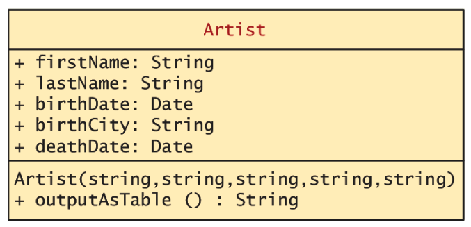
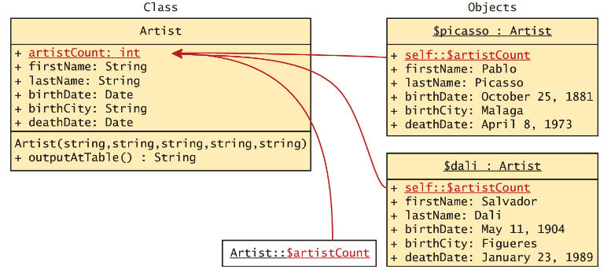
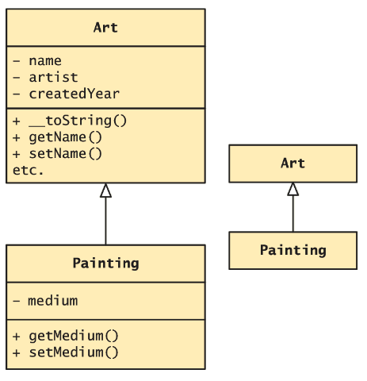
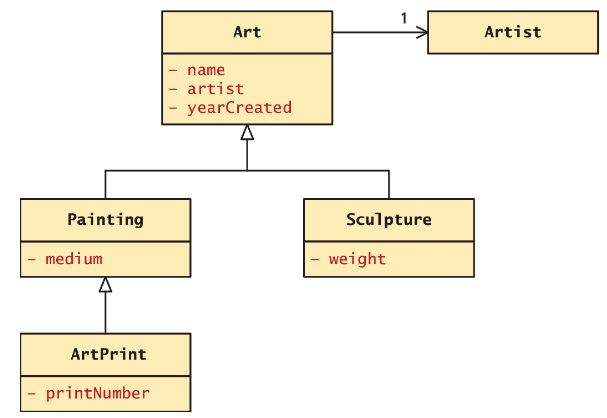
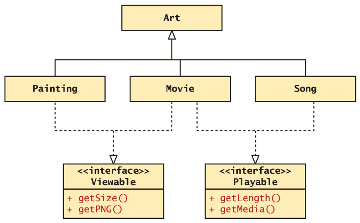

# 1. Index

<!--toc:start-->

- [1. Index](#1-index)
- [2. PHP](#2-php)
  - [2.1. Responsabilità dei WebServer](#21-responsabilità-dei-webserver)
    - [2.1.1. Apache](#211-apache)
  - [2.2. Utilizzare XAMPP](#22-utilizzare-xampp)
- [3. PHP](#3-php)
  - [3.1. Quick-Tour dei comandi](#31-quick-tour-dei-comandi)
    - [3.1.1. Variabili](#311-variabili)
    - [3.1.2. `printf`](#312-printf)
    - [3.1.3. If Else e Switch](#313-if-else-e-switch)
    - [3.1.4. Cicli](#314-cicli)
    - [3.1.5. Includere File](#315-includere-file)
    - [3.1.6. Funzioni](#316-funzioni)
    - [3.1.7. Visibilità](#317-visibilità)
    - [3.1.8. Array](#318-array)
  - [3.2. Array Superglobali](#32-array-superglobali)
  - [3.3. GET e POST](#33-get-e-post)
    - [3.3.1. "Sanificare" le query String](#331-sanificare-le-query-string)
  - [3.4. SERVER](#34-server)
  - [3.5. FILES](#35-files)
    - [3.5.1. Meccanismo _HTML_](#351-meccanismo-html)
    - [3.5.2. Meccanismo _JS_](#352-meccanismo-js)
    - [3.5.3. Meccanismo _PHP_](#353-meccanismo-php)
    - [3.5.4. Spostare File](#354-spostare-file)
  - [3.6. Leggere e Scrivere File](#36-leggere-e-scrivere-file)
    - [3.6.1. Accesso da Stream](#361-accesso-da-stream)
    - [3.6.2. Accesso All-In-Memory](#362-accesso-all-in-memory)
  - [3.7. PHP Object-Oriented](#37-php-object-oriented)
    - [3.7.1. UML](#371-uml)
    - [3.7.2. Oggetti Server e Desktop](#372-oggetti-server-e-desktop)
    - [3.7.3. Classi e Oggetti in PHP](#373-classi-e-oggetti-in-php)
      - [3.7.3.1. Visibilità](#3731-visibilità)
      - [3.7.3.2. Campi statici](#3732-campi-statici)
    - [3.7.4. Data Encapsulation](#374-data-encapsulation)
    - [3.7.5. Ereditarietà](#375-ereditarietà)
      - [3.7.5.1. Classi astratte e Polimorfismo](#3751-classi-astratte-e-polimorfismo)
      - [3.7.5.2. Interfacce](#3752-interfacce)
  - [3.8. Database](#38-database)
    - [3.8.1. Transazioni](#381-transazioni)
    - [3.8.2. Data Definition Statement](#382-data-definition-statement)
    - [3.8.3. Database APIS](#383-database-apis)
    - [3.8.4. Accedere tramite linea di comando](#384-accedere-tramite-linea-di-comando)
    - [3.8.5. Accedere ai Database da _PHP_](#385-accedere-ai-database-da-php)
      - [3.8.5.1. Integrare i dati degli utenti](#3851-integrare-i-dati-degli-utenti)
        - [3.8.5.1.1. Sanificare gli Input](#38511-sanificare-gli-input)
        - [3.8.5.1.2. Prepared Statements](#38512-prepared-statements)
      - [3.8.5.2. Inserire i dati da un oggetto](#3852-inserire-i-dati-da-un-oggetto)
      - [3.8.5.3. Inserire Password](#3853-inserire-password)
      - [3.8.5.4. Liberare le risorse](#3854-liberare-le-risorse)
      - [3.8.5.5. Utilizzare le transazioni](#3855-utilizzare-le-transazioni)
    - [3.8.6. Tecniche con i Database](#386-tecniche-con-i-database)
      - [3.8.6.1. Mostrare liste di link](#3861-mostrare-liste-di-link)
      - [3.8.6.2. Barra di ricerca e risultato](#3862-barra-di-ricerca-e-risultato)
      - [3.8.6.3. Salvare i file](#3863-salvare-i-file)
  - [3.9. Gestione degli errori](#39-gestione-degli-errori)
    - [3.9.1. Error Reporting](#391-error-reporting)
    - [3.9.2. Display Errors](#392-display-errors)
    - [3.9.3. Log Error](#393-log-error)
    - [3.9.4. Gestione Eccezioni](#394-gestione-eccezioni)
    - [3.9.5. Gestire l'input del'utente](#395-gestire-linput-delutente)
    - [3.9.6. Espressioni Regolari](#396-espressioni-regolari)
    - [3.9.7. Validare l'input](#397-validare-linput)
    - [3.9.8. Dove fare la validazione](#398-dove-fare-la-validazione)
      - [3.9.8.1. Validazione `HTML5`](#3981-validazione-html5)
      - [3.9.8.2. Validazione `Javascript`](#3982-validazione-javascript)
        - [3.9.8.2.1. Esempio Finale](#39821-esempio-finale)
        <!--toc:end-->

# 2. PHP

<div class="grid2">
<div>

E' possibile fare un hosting basilare dei file sui web server.
Lo sviluppo _server-side_ è molto di più rispetto al _web hosting_. perché richiede l'utilizzo di linguaggi di programmazione come il **PHP** per creare script in maniera dinamica per poter generare contenuto in maniera dinamica senza la necessità di interagire con il mondo esterno.

Grazie alle risorse _PHP_ possiamo genereare dinamicamente script che cambiaranno ad ogni richiesta.

</div>
<div>

</div>
</div>

Gli script _PHP_ si interfacciano con diverse tecnologie/servizi web:

- _Database_
- _Web Service_
- _Files_
- Servizi _Emal_
- Software terzi

Alcune tecnologie _server-side_ più famose:

- **JSP (_Java Server Pages_)**: oggi un po' obsoleto, utilizza `Java` come linguaggio di programmazione attraverso un approccio _object-oriented_ esplicito. Viene adoperato il larga scala nel framework **J2EE**.
- **Node.js**: un ambiente di esecuzione di linguaggio `JavaScript` lato server, che permette di utilizzare il codice _javascript_ sia lato client sia lato server. `Node.js` ha il proprio _web server software_ e non richiede quindi l'utilizzo di _web server_ terzi.
- **PHP (_Personal Homepages $\to$ PHP: HyperText Preprocessor_)**: è un linguaggio dinamico che può essere inserito direttamente nei file `HTML`, anche se supporta diverse proprietà dei linguaggi _object-oriented_ (classi, ereditarietà,...).
  Le pagine _PHP_ sono compilate in una rappresentazione intermedia chiamata **opcodes** analoghi al _byte-code_ del `Java` o al framework **MSIL** di `.NET`.
  **WordPress** si basa su `PHP`.

## 2.1. Responsabilità dei WebServer

Un web server si occupa di diversi processi:

- Gestire le connessioni HTTP (TCP/IP)
- Risponde a richieste di risorse statiche e dinamiche
- Gestisce i permessi e gli accessi a determinate risorse
- Encripta e comprime dati
- Gestisce diversi domini e URLs
- Gestisce le connessioni tra database
- Gestisce i _cookies_ e gli stati
- Carica e gestisce i file

Per fare ciò può utilizzare diversi software, tra i più famosi abbiamo quelli nello **stack LAMP**:

- Linux (_Sistema Operativo_)
- Apache (_WebServer_)
- MySQL (_DBMS_)
- PHP (_Scripting Language_)

Noi utilizzeremo **LAMP** se su _Linux_ oppure **XAMPP** su _Windows_.

### 2.1.1. Apache

<div class="grid2">
<div>

Il _WebServer_ **Apache** è un intermediario che interpreta le richieste HTTP e decide come gestire la richiesta, lavorando spesso insieme al `PHP`.

_Apache_ esegue un **daemon** sul server, ovvero un **processo in background** che _attende un evento specifico per attivarsi._

</div>
<div>

</div>
<div>

Quando la rischiesta arriva, Apache utilizza dei _moduli_ per determinare come rispondere alla richiesta.
Un **modulo** è un estensione compilata <small>(solitamente scritta in _C_ ) </small> che aiuta il WebServer a _gestire le richieste_.
Per questo motivo sono chiamati anche **handlers**.

</div>
<div>

</div>
</div>

Apache viene eseguito in due modi diversi:

<div class="grid2">
<div>

_<p class="subt">_ Multi-process o _preforked_ </p>

In questo stile ogni processo è mappato su un _core_.

Ha un costo maggiore anche se permette l'esecuzione di un processo su diversi _thread_, velocizandone l'esecuzione.

</div>
<div>

_<p class="subt">_ Multi-Threaded o _worker_</p>

In questo stile ogni processo ha al suo interno una serie di _thread_ che condividono lo stesso spazio.

Ciò implica che devo terminare il processo su un _thread_ prima che ne possa iniziare un'altro.

</div>
</div>


## 2.2. Utilizzare XAMPP

`XAMPP` installa e configura _Apache_, `PHP` e `MySQL`.

Le richieste `PHP` nel nostro browser utilizzano il dominio **localhost** `127.0.0.1`

I file PHP devono essere salvati da quache parte all'interno della cartella `C:\pweb\tools\XAMPP\htdocs`

# 3. PHP

_PHP_ come il _JS_ è un linguaggio interpretato, che utilizza le funzioni cone gli altri linguaggi _object-oriented_.
I file _PHP_ hanno come estensione `.php`.

## 3.1. Quick-Tour dei comandi

Le sintassi per i cicli, gli assegnamenti e le condizioni sono quasi identiche al _JavaScript_.

Sono presenti differenze invece nella dichiarazione di _funzioni_, _classi_ e nella definizione di variabili.

Il codice _PHP_ può essere inserito direttamente nel file _HTML_, tramite il tag `<?php ... ?>`.
In questo caso qualsiasi codice all'interno del tag che si trova fuori dal documento stesso, ha in automatico **echo** al client.

```html
<?php 
    "ABC";
?>

<!DOCTYPE html>
<!-- ... -->

<!-- Equivalente a -->
<?php echo "ABC"; ?>

<!DOCTYPE html>
<!-- ... -->
```

<div class="grid2">
<div>

```html
<?php
    $user = "Randy";
?>
<!DOCTYPE html>
<html>
  <body>
    <h1>Welcome <?php echo $user; ?></h1>
    <p>
      Il server time è <?php echo "<strong>"; echo date("H:i:s"); echo "</strong
      >"; ?>
    </p>
  </body>
</html>
```

</div>
<div>

<p style="text-align: center">Tradotto in:</p>

```php
<!DOCTYPE html>
<html>
  <body>
    <h1>Welcome Randy</h1>
    <p>Il server time è <strong>16:26:34</strong></p>
  </body>
</html>
```

</div>
</div>

Anche se è possibile inserire tutto in un unico file html, l'approccio corretto da utilizzare è quello di **separare gli aspetti implementativi e di utilizzo** tra i file `.html` e `.php` e successivamente _linkarli_:

<div class="grid2">
<div>

`display-artist.php`

```php
<?php
    include "php/classes/artistCollection.php"
    include "php/classes/artist.php"
    # ...
?>

<?php $artist = new ArtistCollection(); ?>

<!DOCTYPE html>
<html>
  <!-- ... -->
  <body>
    <!-- ... -->
    <?php echo $artist->outputEachArtist(); ?>
    <!-- ... -->
  </body>
</html>
```

</div>
<div>

`artistCollection.php`

```php
<?php
class ArtistCollection{
    private $collection = array();

    function __construct(){
        $this->loadFromDataBase();
    }
    public function outputEachArtist(){
        foreach ($this->collection as $artist)
            $artist->output();
    }
    private function leadFromDataBase(){
        // ...
    }
}

```

`artist.php`

```php
<?php
class Artist{
    var $Id;
    var $firstName;
    var $lastName;
    // ...
    public function output(){
        // ...
        echo $this->firstName." ".$this->lastName;
    }
}
```

</div>
</div>

I commenti in PHP possono essere:

```php
# Linea Singola

/*
* Multi
* linea
*/

$artist = readDatabase();   // end-of-line
```

### 3.1.1. Variabili

Le variabili in _PHP_ sono variabilil **dinamiche** a **tipizazzione debole**.
Quando si dichiara una variabile, il suo nome va preceduto dal carattere `$`.

I tipi di dato sono gli stessi del _JS_:

- `Boolean`
- `Integer`
- `Float`
- `String`
- `Array`
- `Object`

Per dichiarare una **costante** si utilizza la funzione `define()`, e dal momento in cui è definita, ci si riferisce ad essa **senza utilizzare il carattere `$`**.

Per fare output si utlizza la funzione `echo()`.

```php
# Costante
define("DATABASE_LOCAL", "localhost");

# Variabile (Integer)
$count = 3;

# Variabile (String)
$string = DATABASE_LOCAL;

echo $count;
    // 3
echo $string;
    // "localhost"
```

Le stringhe possono essere unite in maniera rapida utilizzando il carattere `.`

```php
$username = "World";

echo "Hello" . $username;
    // Hello World

$firstName = "Pablo";
$lastName = "Picasso";

/*
* Le seguenti linee sono identiche
*/
echo '<em>'.$firstName.' '.$lastName.'</em>';
echo "<em> $firstName $lastName </em>";
    // <em>Pablo Picasso</em>


echo "";

echo "";
echo "";
echo '';

echo '<a href="artist.php?id='. $id .'">'. $firstName .' '. $lastName .'</a>';
```

### 3.1.2. `printf`

In alternativa alla funzione `echo()` si può utilizzare la funzione `printf()`, derivata dal `C`, insieme alle sue due varianti:

- `sprintf()`, per le stringhe
- `fprintf()`, per i file.

La funzione prende in ingresso **almeno un parametro stringa**, e dei _placeholders_ opzionali.

```php
$product = "box";
$weight = 1.56789;

printf("Il %s pesa %.2f kili", $product, $weight);
    // Il box pesa 1.57 kili
```

I segnaposto sono così fatti:

- `%`: indica che è un segnaposto
- _**Specificatore**_: indica il tipo della variabile da stampare
  - `b`: binario
  - `d`: interi
  - `f`: float
  - `o`: ottale
  - `x`: esadecimale
  - `s`: stringhe

```php
$firstName = "Mario";
printf("Ciao %s\n", "Amilcare");
    // Ciao Amilcare
printf("Ciao %s\n", $firstName);
    // Ciao Mario
```

Si può anche utilizzare un specificatore di precisione, che nel caso dei `float` ci indica quante cifre decimali vogliamo vedere.
Per utilizzarlo si indica tra il `%` e lo _specificatore_ la stringa `.n`, dove `n` è il numero di cifre desiderate.

### 3.1.3. If Else e Switch

La sintassi è praticamente identica a quella del _JS_:

```php
if($hourOfDay > 6 && $hourOfDay < 12){
    $greeting = "Good Morning";
}
else if($hourOfDay == 12)
    $greeting = "Good Noon Time";
else{
    $greeting = "Good Afternoon or Evening";
}
```

```html
<?php
    if( $userStatus == "loggedIn"){
        echo // ...
    }
    else{
        echo // ...
    }
?>
```

```php
switch($artType){
    case "PT":
        $output = "Painting";
        break;
    case "SC":
        $output = "Sculpture";
        break;
    default:
        $output = "Other"
}
```

### 3.1.4. Cicli

```php
$count = 0;
while($count < 10){
    echo $count;
    $count++;
}

$count = 0;
do{
    echo $count;
    $count++;
} while($count < 10);

for($count = 0; $count < 10; $count++)
    echo $count;
```

Il _PHP_ esiste una sintassi alternativa a quello delle `{}`.
In questa sintassi, le parentesi graffe vengono sostituite:

- `{` $\to$ `:`
- `}` $\to$ `endif;`, `endwhile;`, `endfor;`, `endforeach;`, `endswitch;`.

```html
<?php if($userStatus == "loggedIn") : ?>
<a href="account.php">Account</a>
<a href="logout.php">Logout</a>
<?php else : ?>
<a href="login.php">Login</a>
<a href="register.php">Register</a>
<?php endif; ?>
```

### 3.1.5. Includere File

Il _PHP_ permette di inserire file in altri file.

Per fare ciò esistono 4 diversi modi:

```php
include "somefile.php"      // Se non trova il file da Warning

include_once "somefile.php" // Se il file è gia incluso non fa nulla

require "somefile.php"      // Se non trova il file da Errore

require_once "somefile.php" // Se il file è gia inserito non fa nulla
```

Sia `include` che `require` fanno un copia-incolla nella loro linea del contenuto del file.

### 3.1.6. Funzioni

```php
function getNiceTime(){
    return date("H:i:s");
}

function outputFooterMenu(){
    echo '<div id="footer">';
    echo '<a href=#>Home</a> | <a href=#>Products </a>';
    echo '<a href=#>About Us</a> | <a href=#>Contact Us </a>';
    echo '</div>';
}
```

Le chiamate alle funzioni sono identiche al _C++_,
così come il funzionamento dei **parametri di default** e ai **passaggi per valore e riferimento**.

```php
function getNiceTime($showSeconds = true) {
    if($showSeconds)
        return date("H:i:s");
    else
        return date("H:i");
}

echo getNiceTime(), "<br>";
echo getNiceTime(true), "<br>";
echo getNiceTime(false);
```

```php
function changeParameter($arg) {
    $arg += 300;
    echo "arg = $arg<br>";
}
function changeParameterRif(&$arg) {
    $arg += 300;
    echo "arg = $arg<br>";
}

$initial = 15;
echo "initial=$initial<br>";
    // initial = 15
changeParameter($initial);
    // arg = 315
echo "initial=$initial<br>";
    // initial = 15
changeParameterRif($initial);
    // arg = 315
echo "initial=$initial<br>";
    // initial = 315
```

### 3.1.7. Visibilità

Tutte le variabili definite in un blocco hanno visibilità solo all'interno di questo blocco.

Ciò implica che le variabili definite in una funzione non sono accessibili dall'esterno e <u>viceversa</u>.

Per utilizzare all'interno della funzione variabili esterne va inserito una **specifica esplicita**, tramite _keyword_ `global`:

```php
$count= 56;

function testScope() {
    echo $count;            //! ERRORE! $count non è dichiarato nel corpo della funzione
}

function goodTestScope() {
    global $count;
    echo $count;
}

echo $count;
    // 56

testScope();
    // genera Warning o Errori

goodTestScope();
    // 56
```

### 3.1.8. Array

In _PHP_ un _Array_ è una struttura dati che:

- Raggruppa diversi elementi collegati tra loro
- Permette l'_iterazione_ sul set
- Permette l'accesso a qualsiasi elemento del set.

Il _PHP_ implementa gli _array associativi dinamici_, permettendo l'aggiunta e la rimozione di elementi.

Le chiavi in _PHP_ sono come in _JS_, possono essere **numeri interi $(0 \to n)$** o **stringhe**.
I valori invece possono essere qualsiasi tipo di oggetto, tipo primitivo e non, purché sia supportato in _PHP_.

Per definire un _Array_ si utilizza la funzione `array()` o la notazione con `[]`:

```php
$days = array();
$days[0] = "Mon";
$days[1] = "Tue";
$days = "Wen";      // Il primo indice disponibile

$giorni = array("Lun", "Mar", "Mer");
# Oppure
$giorni = ["Lun", "Mar", "Mer"];
```

E' altrimenti possibile specificare chiave e valore e associarli:

```php
$days = array(0 => "Mon", 1 => "Tue", 2 => "Wed");

$forecast = array("Mon" => 40, "Tue" => 47, "Wed" => 52);
```

Gli **array multidimensionali** non sono altro che _Array di Array_

```php
$month = array(
    array("Mon","Tue","Wed","Thu","Fri"),
    array("Mon","Tue","Wed","Thu","Fri"),
    array("Mon","Tue","Wed","Thu","Fri"),
    array("Mon","Tue","Wed","Thu","Fri")
);
echo $month[0][3];
    // Thu

$cart = array();
$cart[] = array("id" => 37, "title" => "Burial at Ornans", "quantity" => 1);
$cart[] = array("id" => 345, "title" => "The Death of Marat", "quantity" => 1);
$cart[] = array("id" => 63, "title" => "Starry Night", "quantity" => 1);
```

Per poter iterare un array, dobbiamo poter trovare il numero dei suoi elementi.
Per fare ciò si utlizza la funzione `count()`;

```php
for ($i = 0; $i < count($days); $i++){
    echo $days[i];
}
```

Alternativamente è possibile utilizzare il `foreach`

```php
// Itero tra i valori
foreach($forecast as $vaule){
    echo $value;
}

// Itero le coppie di chiave-valore
foreach($forecast as $key => $value){
    echo "day".$key." = ".$value;
}
```

Il _PHP_ permette di inserire elementi in un _Array_ saltando degli indici.

```php
$days = array("Mon","Tue","Wed","Thu","Fri");

$days[7] = "Sat";

// Posso vedere cosa contiene un'Array
print_r($days);
    // Array ([0] => Mon [1] => Tue [2] => Wed [3] => Thu [4] => Fri [7] => Sat)

echo $days[6]
    // NULL
```

Possiamo eliminare un elemento **esplicitamente** utilizzando la funzione `unset()`:

```php
$days = array("Mon","Tue","Wed","Thu","Fri");

unset($days[2]);
unset($days[3]);

// Posso vedere cosa contiene un'Array
print_r($days);
    // Array ([0] => Mon [1] => Tue [4] => Fri)

$giorni = array_values($days);
print_r($giorni)
    // Array ([0] => Mon [1] => Tue [2] => Fri)
```

La funzione `array_values(a)` restituisce tutti i valori di un array specificato `a` _indicizzati numericamente_.

Poiché le chiavi degli _Array_ non hanno necessità di essere né sequenziali né tantomeno numeri interi, è possibile cercare una data chiave all'interno dell'Array tramite la funzione `isset()`:

```php
$dispari = array(1 => "Hello", 3 => "World", 5 => "!");

if(isset($displari[0]))
    echo "C'è qualcosa alla chiave 0";

if(isset($dispari[1]))
    echo "C'è qualcosa alla chiave 1, chiamata" . $dispari[1]

    // C'è qualcosa alla chiave 1, chiamata Hello
```

Esistono anche diverse funzioni per ordinare gli array.
Tra le più comuni troviamo:

- `sort($array)`: ordina per valore
- `asort($array)`: ordina per valore lasciando invariate le coppie chiave/valore

```php
$giorni = ["Lun", "Mar", "Mer", "Gio"];

print_r(sort($giorni));
    // Array ([0] => Gio [1] => Lun [2] => Mar [3] => Mer)
// -- oppure -- //

print_r(asort($giorni));
    // Array ([3] => Gio [0] => Lun [1] => Mar [2] => Mer)
```

Altre funzioni sono:

<div class="flexbox" markdown="1">

| Funzione                                            | Esempio                                                                                 | Descrizione                                                                                                                                 |
| --------------------------------------------------- | --------------------------------------------------------------------------------------- | ------------------------------------------------------------------------------------------------------------------------------------------- |
| `array_keys($someArray)`                            | `array_keys(['a' => 1, 'b' => 2])`                                                      | Restituisce tutte le chiavi, oppure restituisce tutte le chiavi associate a un determinato valore (argomenti aggiuntivi)                    |
| `array_values($someArray)`                          | `array_values(['a' => 1, 'b' => 2])`                                                    | Restituisce tutti i valori                                                                                                                  |
| `array_rand($someArray, $num=1)`                    | `array_rand(['a' => 1, 'b' => 2], 2)`                                                   | Restituisce un set di chiavi casuali                                                                                                        |
| `array_reverse($someArray)`                         | `array_reverse(['a' => 1, 'b' => 2])`                                                   | Restituisce un array invertito nell'ordine dei valori (un altro argomento può essere utilizzato per mantenere le chiavi ancorate ai valori) |
| `array_walk($someArray, $callback, $optionalParam)` | `array_walk(['a' => 1, 'b' => 2], function($value, $key) { echo "$key => $value\n"; })` | Esegue la funzione di callback su tutte le coppie chiave-valore nell'array, l'ultimo parametro viene fornito alla funzione di callback      |
| `in_array($needle, $haystack)`                      | `in_array(1, ['a' => 1, 'b' => 2])`                                                     | Cerca il valore dell'ago nel fieno                                                                                                          |
| `shuffle($someArray)`                               | `shuffle(['a' => 1, 'b' => 2])`                                                         | Mescola i valori, vengono fornite nuove chiavi                                                                                              |

</div>

## 3.2. Array Superglobali

PHP utilizza una serie di array asssociativi predefiniti chiamate **_variabili superglobali_**.
Queste viariabili permettono al programmatore di accedere facilmente agli _header HTTP_, ai parametri delle _query string_ e ad altre informazioni.

## 3.3. GET e POST

Gli array `$_GET` e `$_POST` sono le variabili superglobali più importanti in _PHP_, proprio perché permettono al programmatore di **accedere a dati inviati dagli utenti** tramite _query string_.

<div class="grid2">
<div class="top">

```html
<form action="processLogin.php" method="GET">
  <label>Nome</label><input type="text" name="uName" /> <label>Password</label
  ><input type="pass" name="uPass" />
</form>
```

Produco la sequente richiesta:
`GET processLogin.php?uName=ricardo&uPass=pw01`

</div>
<div class="top">

```php
    echo $_GET["uName"];
        // ricardo
    echo $_GET["uPass"]
        // pw01
```

</div>
</div>

Le richieste, a seconda che siano effettiate tramite metodo `GET`/`POST`, sono inserite nell'array `$_GET`/`$_POST`.

Questo semplifica l'accesso ai dati perché possiamo gestire in maniera diversa i dati inviati a seconda del metodo utilizzato.

```php
if($_SERVER["REQUEST_METHOD"] == "POST"){
    if(isset($_POST["uName"])) && isSet($_POST["pass"]){
        // --- gestione dati --- //
        echo "... gestendo il login adesso ..."
        echo "... rindirizzamento/autenticazione in corso ..."
        echo "... nascondiamo il form o alto ..."
    }
}
else{
    // ...
}
```

Certe volte nei `<form>` è possibile avere più valori associati ad un singolo nome, come nel caso delle _checkbox_:

```html
<form method="get">
  Seleziona il giorno quando sei libero <br />
  <label>Lunedì</label>
  <input type="checkbox" name="day" value="Lunedì" /><br />
  <label>Martedì</label>
  <input type="checkbox" name="day" value="Martedì" /><br />
  <label>Mercoledì</label>
  <input type="checkbox" name="day" value="Mercoledì" /><br />
  <label>Giovedì</label>
  <input type="checkbox" name="day" value="Giovedì" /><br />
  <label>Venerdì</label>
  <input type="checkbox" name="day" value="Venerdì" /><br />
  <input type="submit" value="Invia" />
</form>
```

In questi casi se l'utente ha selezionato più di un giorno e invia il form, il valore di `$_GET["day"]` conterrà **solo l'ultimo valore selezionato dalla lista**.

Per superare questa limitazione è necessario cambiare il nome dell'attributo nel file HTML in `day[]`.

```html
<form method="get">
  Seleziona il giorno quando sei libero <br />
  <label>Lunedì</label>
  <input type="checkbox" name="day[]" value="Lunedì" /><br />
  <label>Martedì</label>
  <input type="checkbox" name="day[]" value="Martedì" /><br />
  <!-- ... -->
</form>
```

### 3.3.1. "Sanificare" le query String

Il fatto che ci aspettiamo che le _query string_ vengano inviate al server in maniera corretta, non è detto che questo verrà fatto.
La regola generale è:

> **Non fidarti degli utenti**

Perciò è **sempre necessario** verificare gli input degli utenti.

## 3.4. SERVER

L'array associativo `$_SERVER` contiene:

- **L'header della richiesta HTTP**
- Opzioni di configurazione _PHP_

Per utilizzare l'array `$_SERVER` ci si riferisce così:

```php
echo $_SERVER["SERVER_NAME"] . "<br>";
echo $_SERVER["SERVER_SOFTWARE"] . "<br>";
echo $_SERVER["REMOTE_ADDR"] . "<br>";
```

<figure class="80">

<figcaption>

E' possibile recuperare le informazioni dalla richiesta _HTML_.

</figcaption>
</figure>

<div class="flexbox" markdown="1">

| Chiave            | Descrizione                                                                                              |
| ----------------- | :------------------------------------------------------------------------------------------------------- |
| `SERVER_NAME`     | il nome del sito che ha effettuato la richiesta (_Apache_)                                               |
| `SERVER_ADDR`     | indirizzo IP del server                                                                                  |
| `DOCUMENT_ROOT`   | indica la locazione nella quale stiamo eseguento lo _script_                                             |
| `SCRIPT_NAME`     | identifica lo _script_ che stiamo attualmente eseguento                                                  |
| `REQUEST_METHOD`  | Restituisce il metodo di richiesta utilizzato per accedere alla pagina (`GET`/`POST`/`HEAD`/`PUT`)       |
| `REMOTE_ADDR`     | Restituisce l'indrizzo IP dell'utente che richiede la pagina                                             |
| `HTTP_USER_AGENT` | Contiene informazioni sul browser e sull'OS del _client_ che effettua la richiesta. <br> **Può mentire** |
| `HTTP_REFERER`    | Contiene l'indirizzo della pagina che ha reindirizzato su questa tramite _link_. <br> **Può mentire**    |

</div>

```php
echo $_SERVER["HTTP_USER_AGENT"];

$browser = get_browser($_SERVER["HTTP_USER_AGENT"], true);
print_r($browser);
```

```php
$previousPage = $_SERVER["HTTP_REFERER"];

if(strpos("search.php", $previousPage) != 0){
    echo "<a href='search.php'> Torna alla ricerca </a>";
}
```

## 3.5. FILES

E' un array associativo che contiene **elementi che sono stati caricati dall'utente nella richiesta**.

L'array contiene una coppia `key`, `value` per ogni file caricato nel `POST`:

- `key`: è il `name` del tag nel `<form>`
- `value`: sarà le informazioni sul file stesso.

Per inviare file bisogna innanzitutto utilizzare il metodo `POST`.
Inoltre deve essere aggiunto l'attributo `enctype="multipart/from-data"` nel `<form>`.

```html
<form enctype="multipart/from-data" method="post">
  <input type="file" name="file1" id="file1" />
  <input type="submit" />
</form>
```

Le chiavi più importanti per `$_FILES` sono: `name`, `type`, `tmp_name`, `error` e `size`.

<div class="flexbox" markdown="1">

| Funzione   | Descrizione                                                                                                                                    |
| ---------- | ---------------------------------------------------------------------------------------------------------------------------------------------- |
| `name`     | Una stringa che contiene il nome completo del file utilizzato sul computer client, inclusa l'estensione del file.                              |
| `type`     | Definisce il tipo MIME del file.                                                                                                               |
| `tmp_name` | Il percorso completo della posizione sul server dove il file viene temporaneamente memorizzato.                                                |
| `error`    | Un intero che codifica molti possibili errori. Viene impostato su `UPLOAD_ERR_OK` (valore intero 0) se il file è stato caricato correttamente. |
| `size`     | Un intero che rappresenta la dimensione in byte del file caricato.                                                                             |

</div>

Ci sono 3 meccanismi principali per avere delle restiioni sulla grandezza dei file:

- Tramite _HTML_
- Tramite _JS_
- Tramite _PHP_

### 3.5.1. Meccanismo _HTML_

Si introduce un tag di input nasconsto, con nome `MAX_FILE_SIZE` e un certo `value` all'interno del form.

```html
<form enctype="multipart/from-data" method="post">
  <input type="hidden" name="MAX_FILE_SIZE" value="1000000" />
  <input type="file" name="file1" id="file1" />
  <input type="submit" />
</form>
```

E' un meccanismo possibile **solo nelle pagine PHP**, e non è affidabile, poiché l'utente può editare il sorgente della pagina HTML e bypassarlo.

### 3.5.2. Meccanismo _JS_

Permette un controllo lato client prima della trasmissione.

```js
var file = document.getElementById("file1");
var max_size = document.getElementById("max_file_size").value;
if (file.files && file.files.length == 1)
  if (file.files[0].size > max_size)
    alert("Il file deve essere più piccolo di " + max_size / 1024 + "KB");
```

Anche questo è facilmente bypassabile fagli utenti.

### 3.5.3. Meccanismo _PHP_

L'ultima opzione quella di limitare le dimensioni con un smeplice controllo lato server.

```php
$max_file_size = 1000000;
foreach($_FILES as $fileKey => $fileArray){
    if($fileArray["size"] > $max_file_size){
        echo "Error: ". $fileKey . " è troppo grande";
    }
    printf("%s è %.2f KB", $fileKey, $fileArray["size"]/1024);
}
```

Questi controlli possono essere effettuati anche per limitare il tipo dei file che l'utente può inviare:

```php

$validExt = array("jpg", "png");
$validMime = array("image/jpeg", "image/png");
foreach($_FILES as $fileKey => $fileArray){
    $ext = end(explode(".", $fileArray["name"]));

    if(in_array($fileArray["type"], $validMime) && in_array($ext, $validExt))
        echo "Tutt'OK";
    else
        echo $fileKey." Ha mime type o estensione non valida";
}
```

Questi controlli non sono infallibili, infatti è possibile per l'utente inviare un file con l'estensione corretta che però contiene altre informazioni.

### 3.5.4. Spostare File

I file inviati sono temporanei, e molto spesso si vuole spostarli in una cartella sul server per renderli **permanenti**.

Per fare ciò si utilizza la funzione `move_uploaded_file()`:

```php
$file = $_FILES["file1"]["tmp_name"];
$destinazione = "./upload/". $_FILES["file1"]["name"];

if(move_uploaded_file($file, $destinazione))
    echo "Tutt'OK";
else
    echo "C'è stato un problema durante lo spostamento del file";
```

## 3.6. Leggere e Scrivere File

Ci sono due modalità principali per leggere/scrivere file in _PHP_:

- **Accesso da Stream**: il codice legge una piccola porzione del file alla volta. Richiede un'attenzione maggiore nella programmazione, ma è il metodo più efficace (_memory-wise_) per leggere grossi file.
- **Accesso All-In-Memory**: leggiamo l'intero file nella memoria. Non è approprieto per file grossi, ma rende estremamente semplice processare piccoli file.

### 3.6.1. Accesso da Stream

E' uno stile molto simile al C.
Utilizza diverse funzioni:

- `fopen()`: prende come parametri una locazione/URL e una modalità di accesso. Ritorna una **stream resource** che è possibile leggere in maniera sequenziale
- `fread()`/`fgets()`: legge una porzione di file
- `fwrite()`: scrive su una porzione del file
- `fclose()`: chiude il file

```php
// Apro in lettura
$f = fopen("esempio.txt", "r");
$ln = 0;
while($ln = fgets($f)){
    $ln++;
    printf("%2d: %s", $ln++, $line);
}
fclose($f);
```

### 3.6.2. Accesso All-In-Memory

Utilizza anch'esso diverse funzioni:

- `file()`: inserisce l'intero file in un **array**, dove ogni elemento dell'array corrisponde a **una linea nel file**
- `file_get_contents()`: legge l'intero file in una **variabile stringa**
- `file_put_contents()`: scrive il contenuto di una **variabile stringa su file**

```php
$fileAsString = file_get_contents("example.txt");
$fileAsString .= "\n L'ho aggiunto ora!";

file_put_contents("example.txt", $fileAsString);
```

Immaginiamo di avere questo file `esempio.txt`:

```txt
01070,Picasso,The Actor,1904
01080,Picasso,Family of Saltimbanques,1905
02070,Matisse,The Red Madras Headdress,1907
05010,David,The Oath of the Horatii,1784
```

Il codice PHP per leggerlo:

```PHP
$quadri = file("example.txt") or die("ERROR: Impossibile trovare il file");

$delimiter = ",";

foreach ($quadri as $quadro) {
    $campoQuadro = explode($delimiter, $quadro);

    $id = $campoQuadro[0];
    $artista = $campoQuadro[1];
    $titolo = $campoQuadro[2];
    $anno = $campoQuadro[3];
}

```

## 3.7. PHP Object-Oriented

_PHP_ è un linguaggio _object-oriented_ a tutti gli effetti con molte delle costruzioni sintattiche di linguaggi come `Java` e `C++`.

Le versioni di _PHP_ precedenti alla 5.0 supportano tutte le funzionalità orientate agli oggetti, mentre quelle successive sì.

La struttura _Obj-Oriented_ permette di pensare agli oggetti con determinate _propiretà_ (**data members**) e _metodi_.

Le variabili create da una classe si chiama **istanza**.

### 3.7.1. UML

Lo standard per creare diagrammi per linguaggi _object-oriented_ è definito da **UML (_Unified Modeling Language_)**.

I diagrammi delle classi/oggetti sono utili per descriverne proprietà, metodi e relazioni.

La sintassi completa si trova al seguente [link](https://www.omg.org/spec/).

<div class="grid2">
<div>

Ipotiziamo di avere una serie di artisti dove ognuno ha:

- first name
- last name
- birth date
- birth city
- death date

Tramite oggetti possiamo incapsulare queste propretà tutte insieme.

</div>
<div>

</div>
</div>

### 3.7.2. Oggetti Server e Desktop

E' importante differenziare tra oggetti server e desktop.

Mentre il software desktop può essere caricato in memoria ed essere utilizzato in diverse occasioni, un oggetto _PHP_ ha _lifespan_ uguale a quella della **richiesta HTTP**.

Dobbiamo quindi utilizzare le classi in maniera differente da come faremmo nei file su desktop, anche perché potenzialmente possiamo avere centinaia di migliaia di utenti che effettuano richieste contemporaneamente, ognuna delle quali potrebbe caricare oggetti in memoria.


### 3.7.3. Classi e Oggetti in PHP

La sintassi per definire una classe è la seguente:

```php
class Artista{
    public  $nome;
    public  $cognome;
    public  $dataDiNascita;
    public  $cittaDiNascita;
    public  $dataDiMorte;
}

$picasso = new Artist();
$dali = new Artist();
```

Dopo aver istanziato un oggetto ci si riferisce alle sue proprietà tramite _operatore freccia_ `->`:

```php
$picasso->$nome = "Pablo";
$picasso->$cognome = "Picasso";
$picasso->$dataDiNascita = "Malaga";
$picasso->$cittaDiNascita = "25 Ottobre 1881";
$picasso->$dataDiMorte = "8 Aprile 1973";
```

Esiste anche una funzione _costruttore_ definita dal nome `__construct()` che si riferisce ai parametri della classe tramite la sintassi `$this->`:

```php
class Artista{
    public  $nome;
    public  $cognome;
    public  $dataDiNascita;
    public  $cittaDiNascita;
    public  $dataDiMorte;

    function __costruct($nome, $cognome, $datNascita, $cittaDiNascita, $dataDiMorte = null){
        $picasso->$nome = $nome;
        $picasso->$cognome =$cognome;
        $picasso->$dataDiNascita = $dataDiNascita;
        $picasso->$cittaDiNascita = $cittaDiNascita;
        $picasso->$dataDiMorte = $dataDiMorte;
    }
}

$picasso = new Artist("Pablo", "Picasso", "Malaga", "25 Ottobre 1881", "8 Aprile 1973");
```

I **metodi** sono associati ad una classe e si comportano come le funzioni:

```php
class Artist{
    // ...
    public function outputAsTable(){
        $table .= "<table>";
        $table .= "<tr><th colspan='2'>";
        $table .= $this->nome." ". $this->cognome;
        $table .= "</th></tr>";
        $table .= "<tr><td>Nascita:</td>";
        $table .= "<td>". $this->dataDiNascita;
        $table .= "(". $this->cittaDiNascita .")</td></tr>";
        $table .= "<tr><td>Morte:</td>";
        $table .= "<td>". $this->dataDiMorte ."</td></tr>";
        $table .= "</table>";
        return $table;
    }
}
```

Il diagramma _UML_ di una classe con metodi è il seguente:



Nelle classi posso definire membri costanti:

```php
class X{
    public const PRIMA = "Sono costante";

    // ...
    private function f(){
        echo self::PRIMA;
    }
}


$stringa = X::PRIMA;
```

#### 3.7.3.1. Visibilità

I membri di una classe possono avere visibilità uguale a quelle del C++:

- `public`: visibile **a chiunque**
- `private`: visibile **solo dall'interno** della classe
- `protected`: visibile dall'interno e dalle _classi ereditarie_

<div class="grid2">
<div>

```php
class Quadro{
    public $title;
    private $profit;

    public function doThis(){
        $a = $this->profit;         // OK
        $b = $this->title;          // OK
        $c = this->doSecretThat();  // OK
    }

    private function doSecretThat(){
        $a = $this->profit;         // OK
        $b = $this->title;          // OK
    }
}

$p1 = new Painting();

$x = $p1->title;        // OK
$x = $p1->profit;       // ERRORE
$p1->doThis();          // OK
$p1->doSecretThat();    // OK
```

</div>
<div>

</div>
</div>

#### 3.7.3.2. Campi statici

Come in C++, è una proprietà comune tar tutte le istanze di una classe.

I membri statici utilizzano la notazione `self::` e non sono associati ad un unico oggetto.

Vi si può accedere così:

```php
class Artista{
    public static $artistCount = 0;
    public  $nome;
    public  $cognome;
    public  $dataDiNascita;
    public  $cittaDiNascita;
    public  $dataDiMorte;

    function __costruct($nome, $cognome, $datNascita, $cittaDiNascita, $dataDiMorte = null){
        $picasso->$nome = $nome;
        $picasso->$cognome =$cognome;
        $picasso->$dataDiNascita = $dataDiNascita;
        $picasso->$cittaDiNascita = $cittaDiNascita;
        $picasso->$dataDiMorte = $dataDiMorte;
        self::$artistCount++;
    }
}
```



### 3.7.4. Data Encapsulation

La possibilità dell'encapsulation è il vantaggio più grande delle classi.
In questo modo possiamo infatti nascondere i dettagli di un oggetto, e permettere agli utenti solo i diritti di lettura o scrittura, e in questo caso è possibile verificare l'input.

<div class="grid2">
<div>

```php
public function getFirstName(){
    return $this->firstName;
}

public function setDeathDate($data){
    // ....
    $this->$dataDiMorte = $data;
}

// tutti gli altri getter

// tutti gli altri setter
```

</div>
<div>

</div>
</div>

Un esempio di utilizzo può essere il seguente:

```php
<html>
<body>
<h2>Tester per la classe Artist</h2>
<?php
    // prima bisogna includere la definizione della classe
    include 'Artist.class.php';

    // ora crea un'istanza della classe Artist
    $picasso = new Artist("Pablo", "Picasso", "Malaga", "25 ott 1881", "8 apr 1973");

    // stampa alcuni dei suoi campi per testare i getter
    echo $picasso->getLastName(). ': ';
    echo date_format($picasso->getBirthDate(), 'd M Y') . ' a ';
    echo date_format($picasso->getDeathDate(), 'd M Y') . '<hr>';

    // crea un'altra istanza e testala
    $dali = new Artist("Salvador", "Dali", "Figures", "11 mag 1904", "23 gen 1989");
    echo $dali->getLastName() . ': ';
    echo date_format($dali->getBirthDate(), 'd M Y'). ' a ';
    echo date_format($dali->getDeathDate(), 'd M Y'). '<hr>';

    // testa il metodo di output
    echo $picasso->outputAsTable();
    // infine testa il metodo statico: nota la sua sintassi
    echo '<hr>';
    echo 'Numero di artisti istanziati: '. Artist::getArtistCount();
?>
</body>
</html>
```

### 3.7.5. Ereditarietà

L'ereditarietà permette di creare nuove classi che utilizzano, estendono e modificano il comportamento di altre classi.

Il _PHP_ permette di ereditare **solamente una classe alla volta**, e la classe che eredita è chiamata **sottoclasse** o **classe derivata**.
La classe ereditata si chiama **superclasse** o **classe base**.

<div class="grid2">
<div>

```php
class Quadro extends Arte{
    // ...
}
```

```php
$p = new Painting();
// ...
echo $p->getName();     // superclasse
echo $p->getMedium();   // sottoclasse
```

Le classi ereditate **non possono ereditare i metodi privati della superclasse**.
Possono però riferirsi ai metodi delle loro superclassi tramite operatore `parent::`.

</div>
<div>

</div>
</div>

#### 3.7.5.1. Classi astratte e Polimorfismo

Le classi astratte sono classi delle quali **non è possibile creare istanze**.
Si utilizzano esclusivamente come _superclassi_ per altre classi.

<div class="grid2">
<div>

```php
abstract class Art{
    private $name;
    private $artist;
    private $yearCreated;
}

class Painting extends Art{
    private $medium;

    public function __toString(){
        return parent::__toString() . ", Medium: ". $this->getMedium();
    }
}

class Sculpture extends Art{
    private $weight;

    public function __toString(){
        return parent::__toString() . ", Weight: ". $this->getWeight() . "kg";
    }
}
```

</div>
<div>

<figure class="100">

<figcaption>

L'1 sulla freccia in alto si riferisce al fatto che ci sarà in `Art` **1** riferimento a un `Artist`.

</figcaption>
</figure>
</div>
</div>

Queste classi possono essere così utilizzate:

```html
<?php
    $picasso = new Artist("Pablo", "Picasso", "Malaga", "May 11,904","Apr 8, 1973");
    $guernica = new Painting("1937", $picasso, "Guernica", "Oil on canvas");
    $woman = new Sculpture("1909", $picasso, "Head of a Woman", 30.5);
?>
<h2>Paintings</h2>
<p><em>Use the __toString() methods </em></p>
<p><?php echo $guernica; ?></p>
<h2>Sculptures</h2>
<p><?php echo $woman; ?></p>
```

Il **polimorfismo** indica la possibilità di vedere un oggetto da più punti di vista differenti.

Ad esempio:

```php
$guernica = new Painting("1937", $picasso, "Guernica", "Oil on canvas");
```

E' sia un oggetto `Painting` sia un oggetto `Art`, e si comporterà in modo diverso a seconda dei metodi che chiamiamo.

Il _polimorfismo_ ci permette inoltre di gestire liste di oggetti e chiamare lo stesso metodo sovrascritto per ognunn elemento.

```php
$picasso = new Artist("Pablo", "Picasso", "Malaga", "Oct 25, 1881", "Apr 8, 1973");

// Crea i dipinti
$guernica = new Painting("1937", $picasso, "Guernica", "Oil on canvas");
$chicago = new Sculpture("1967", $picasso, "Chicago", "454");

// Creo un vettore
$works = array();
$works[0] = $guernica;
$works[1] = $chicago;

// Testo il polimorfismo
foreach ($works as $art) {
    echo $art;
    // Ad ogni chiamata verrà utilizzato il corretto metodo __toString()
}

// E' possibile aggiungere qualsiasi tipo di Art
$picasso->addwork($guernica);
$picasso->addwork($chicago);


foreach ($picasso->getworks() as $art) {
  echo $art;
}
```

#### 3.7.5.2. Interfacce

L'interfaccia di un'oggetto è un modo per dichiarare _senza implementare_ una **lista formale di metodi che una classe <u>deve</u> implementare**.

```php
interface Viewable{
    public function getSize();
    public function getONG();
}
```

In _PHP_ si dice che una classe **implementa un'interfaccia**:

```php
class Painting extends Art implements Viewable{
    // ...
    public function getSize(){
        // ...
    }
    public function getPNG(){
        // ...
    }
}
```

Adesso la classe `Painting` <u>**deve necessariamente**</u> implementare i metodi `getSize()` e `getPNG()`.
Le interfacce permettono di bypassare il limite della singola ereditarietà.

In _UML_ lo si rappresenta così:


<div class="grid2">
<div>

```php
interface Logger {
    public const NORMAL = 1;
    public const DEBUG = 2;
    public function log($level, $message);
}

abstract class AbstractLogger implements Logger {
    private $level;

    public function __construct($level) {
        $this->level = $level;
    }

    public function log($level, $message) {
        if($this->level >= $level) {
            $this->transfer($message);
        }
    }

    protected abstract function transfer($mes);
}

class FileLogger extends AbstractLogger {
    private $file;

    function __construct($filename, $level) {
        parent::__construct($level);
        $this->file = fopen($filename, "a");
    }

    protected function transfer($message) {
        fwrite($this->file, $message . "\n");
    }
}
```

</div>
<div>

```php
$fl = new FileLogger("out.txt", Logger::NORMAL);

$fl->log(Logger::NORMAL, "first message"); // Logged

$fl->log(Logger::DEBUG, "second message"); // Not logged

/*
*  Tipi:
* BTW: True è convertito nella stringa "1", mentre false è convertito
* nella stringa "" (vuota).
* Questo permette una conversione in entrambi i sensi tra bool e string
*/

echo "fl is a FileLogger: ". ($fl instanceof FileLogger);
    // fl is a FileLogger: 1
echo "\nfl is a Logger: ". ($fl instanceof Logger);
    // fl is a Logger: 1
echo "\nfl is an AbstractLogger: ". ($fl instanceof AbstractLogger);
    // fl is an AbstractLogger: 1
echo "\nfl is a String: ". ($fl instanceof String);
    // fl is a String:

```

</div>
</div>

## 3.8. Database

I database permettono di implementare uno dei più importanti principi nel _software design_:

> Bisogna **separare** ciò che varia e ciò che resta uguale


### 3.8.1. Transazioni

Ogni volta che una pagina _PHP_ effettua dei cambiamenti in un database tramite `UPDATE`, `INSERT` O `DELETE` bisogna essere consapevoli di un possibile **fallimento**.

Le **transizioni** si riferiscono ad una sequenza di passaggi trattati come _singola unità_, per fornire un modo compatto e funzionale per gestire errori e mantenere i dati consistenti quando quest'ultimi occorrono.

Un esempio di transazione può essere il seguente:

> 1. Scrivi il record degli ordini sul database
> 2. Controlla se il pagamento è stato accettato
> 3. Se è accettato invia un messaggio al sistema di ordini
> 4. Rimuovi gli item
> 5. Invia un messaggio al provider di trasporti

### 3.8.2. Data Definition Statement

Le feature _SQL_ di **Data Manipulation Language (_DML_)** includono `SELECT`, `UPDATE`, `INSERT` e `DELETE`.

Esiste anche un linguaggio di **data definition (_DDL_)** utilizzata per creare, modificare, eliminare tabelle e creare e eliminare database.

Questi possono essere utilizzati direttamente **da linea di comando** o indirettamente come con le _**phpMyAdmin** management tool_ o il software _MySQL Workbench_ (anche se tende a dare problemi con macchine MAC OS basate su ARM).

### 3.8.3. Database APIS

La sigla **API** sta per _Application Programming Interface_ e in generale si riferisce alle classi, ai metodi, alle funzioni e alle variabili che un'applicazione utilizza per performare delle task.

Alcune **API** funzionano solamente con dei tipi specifici di database, altre invece supportano il _cross-platform_ e possono lavorare con _diversi database_.

Le **API** che mettono in comunicazione _PHP_ e _MySQL_ sono diverse:

- **MySQL extension**: E' stata rimpiazzata da **mysqli** ed è utilizzata solo per versioni precedenti a `MySQL 4.1.3`
- **mysqli extension**: Fornisce sia un <u>approccio _procedurale_</u> che _object-oriented_ e supporta le ultime feautre di MySQL, successiva alla 4.1.3.
- **PDOs (_PHP data objects_)**: Ha un <u>approccio _object-oriented_</u>

### 3.8.4. Accedere tramite linea di comando

Per lanciare una sessione interattiva di MySQL da linea di comando, è necessario specificare:

- Host (`localhost`)
- Username (`root`)
- Nome Database

`mysql -h 192.168.1.14 -u bookUser -p`

Successivamente le varie query verranno separate da `;`.

Se vogliamo utilizzare le query da file si redireziona: `mysql -h 192.168.1.14 -u bookUser -p < comandi.sql`

### 3.8.5. Accedere ai Database da _PHP_

Le interazioni di base per connettersi ad un database sono le medesime per ogni _API_:

1. Connettersi
2. Gestire errori di connessione
3. Eseguire la query SQL
4. Processare i risultati
5. Liberare le risorse e chiudere le connessioni

Vediamo un approccio _PDO basato su eccezioni_:

```php
try{
    // Punto 1
    $connString = "mysql:host=localhost;dbname=bookcrm";
    $user = "testuser";
    $pass = "mypassword";

    $pdo = new PDO($connString, $user, $pass);
    $pdo->setAttribute(PDO::ATTR_ERRMODE, PDO::ERRMODE_EXCEPTION);

    // Punto 3
    $sql = "SELECT * FROM Categories ORDER BY CategoryName";
    $result = $pdo->query($sql);

    // Punto 4
    while($row = $result->fetch()){
        echo $row['ID'] . " - " . $row['CategoryName'] . "<br>";
    }

    /*
    * fetch(): restituisce una riga dei risultati come array associativo
    */

    // Punto 5
    $pdo = null;
}
// Punto 2
catch(PDOException $e){
    die($e->getMessage());
}
```

Se avessimo utilizzato un approccio procedurale tramite _mysqli_, avremmo avuto la seguente parte 1:

```php
$host = "localhost";
$database ="bookcrm";
$user = "testuser";
$pass = "mypassword";

$connection = mysqli_connect($host, $user, $pass, $databasse);
```

Inserire in maniera ripetuta i dettagli delle connessioni nel codice non è ideale, questi dettagli dovrebbero essere invece definiti come costanti:

```php
define('DBHOST', 'localhost');
define('DBNAME', 'bookcrm');
define('DBUSER', 'testuser');
define('DBPASS', 'mypassword');
```

Per gestire gli errori esistono tecniche diverse a seconda del tipo di connessione che utilizziamo:

- _mysqli_: una serie di `if...else`
- _PDO_: utilizzando le eccezioni in blocchi `try...catch`. _PDO_ ha **3 differenti modalità di errore**.

Per recuperare i risultati di una query:

```php
$sql = "SELECT * FROM Categories ORDER BY CategoryName";

// mysqli
$result = mysqli_query($connection, $sql);

// PDO
$result = $PDO->query($sql);
```

Per le query che non ritornano dati:

```php
$sql = "UPDATE Categories SET CategoryName='Web' WHERE CategoryName='Business'";

// mysqli
if(mysqli_query($connection, $sql)){
    $count = mrsqli_affected_rows($connection);
    echo "<p> Updated" . $count . "rows</p>";
}

// PDO
$count = $pdo->exec($sql);
echo "<p> Updated" . $count . "rows</p>";
```

#### 3.8.5.1. Integrare i dati degli utenti

E' possibile anche effettuare degli inserimenti nei database a partire da dati forniti da un utente tramite `<form>`:

```php
$from = $_POST['old'];
$to = $_POST['new'];
$sql = "UPDATE Categories SET CategoryName='$to' WHERE CategoryName='$form'";

$count = $pdo->exec($sql);
```

Questo script funziona ma è **vulnerabile a attacchi di SQL injection**.

Ipotizziamo di avere il seguente script:

<div class="grid2">
<div class="">

```php
// ...
$user = $_POST['username'];
$pass = $_POST['pass'];
$sql = "SELECT *
         FROM Users
         WHERE uname='$user'
           AND passwd=MD5('$pass')";
sqli_query($sql);
// ...
```

</div>
<div class="">

In questo caso la funzione `MD5()` è una funzione di _crittografia della password_, che associa a `$pass` un valore di _hash_ così da rendere molto difficile ricavare la password associata ad esso.

La funzione `MD5` oggi **non è più considerata sicura** e più avanti vedremo altre funzioni che eseguiranno degli _hash_ più sicuri.

</div>
</div>
<div class="alert">

Non vanno **MAI** inserite le password in chiaro.

</div>

Nel caso in cui l'utente inserisca dei valori accettabili tutto funziona come dovrebbe.
Se un malintenzionato inserica il seguente valore:

```php
$user = "'; TRUNCATE TABLE Users; #"
/*
* Termino quello che c'è prima
* Elimino la tabella
* Commento il resto
*/
```

Andremo a **perdere tutti i nostri valori**.

Per proteggerci da questi attacchi essitono due metodi:

- "**Sanificare**" gli input (non protegge completamente)
- Utilizzare **Prepared Statements**

##### 3.8.5.1.1. Sanificare gli Input

Tutti i database hanno una fnuzione che permette di rimuovere/ dei caratteri dagli input dell'utente.

Le due funzioni sono `mysqli_escape_string()` e `$pdo->quote()`.
Queste funzioni rimuovono i caratteri: `NUL`, `\n`, `\r`, `\`, `'`, `"` e la combinazione `ctrl+z`

##### 3.8.5.1.2. Prepared Statements

Utilizzare le **prepared statemens** è un metodo per migliorare le _performance_ delle query e integrare automaticamente la **sanifica degli input**, così da proteggere dalla _SQL injection_:

<div class="grid2">
<div class="top">

```php
$id = $_GET['id'];

// notare il parametro ?
$sql = "SELECT Title, CopyrightYear
        FROM Books
        WHERE ID=?";

// Prepared Statement - mysqli
if($statement = mysqli_prepare($conection, $sql)){
    /*
    * Associa ai parametri un tipo:
    *  - b: blob
    *  - s: string
    *  - i: int
    *  - ...
    */
    mysqli_stmt_bind_param($statement, 'i', $id);

    // esegue la query
    mysqli_stmt_execute($statement);
}
```

</div>
<div class="top">

```php
$id = $_GET['id'];


// Prepared Statement - PDO (1)
$sql = "SELECT Title, CopyrightYear
        FROM Books
        WHERE ID=?";
$statement->bindValue(1, $id);
$statement = $pdo->prepare($sql);

// Prepared Statement - PDO (2) (Utile quando ci sono tanti parametri)
$sql = "SELECT Title, CopyrightYear
        FROM Books
        WHERE ID=:id";
$statement = $pdo->prepare($sql);
$statement->bindValue(':id', $id);


$statement->execute();
```

</div>
</div>

Per processare i risultati:

<div class="grid2">
<div class="top">

```php
$sql = "SELECT *
        FROM Categories
        ORDER BY CategoryName";

if($result = mysqli_query($connection, $sql)){
    while($row = mysqli_fetch_assoc($result)){
        echo $row['ID'] . " - " . $row['CategoryName'];
        echo '<br>';
    }
}

```

</div>
<div class="top">

```php
$sql = "SELECT *
        FROM Categories
        ORDER BY CategoryName";

$result = $pdo->query($sql);

while($row = $result->fetch()){
    echo $row['ID'] . " - " $row['CategoryName'];
    echo '<br>';
}
```

</div>
</div>

Nel caso un cui utilizzassimo delle **prepared statements**:

```php
$sql = "SELECT Title, CopyrightYear
        FROM Books
        WHERE ID = ?";

if($statement = mysqli_prepare($connection, $sql)){
    mysqli_stmt_bindm($statement, 'i', $id);
    mysqli_stmt_execute($statement);

    mysqli_stmt_bind_result($statement, $title, $year);

    while(mysqli_stmt_fetch($statement)){
        echo $title . ' - ' . $year;
        echo "<br>";
    }
}
```

#### 3.8.5.2. Inserire i dati da un oggetto

Consideriamo al seguente classe:

```php
class Book{
    public $id;
    public $title;
    public $copyrightYear;
    public $description;
}
```

Proviamo ad inserire i risultati della query in un nuovo oggetto:

```php
$id = $_GET['id'];

$sql = "SELECT id, title, copyrightYear, description
        FROM Books
        WHERE id=?";

$statement = $pdo->prepare($sql);
$statement->bindValue(1, $id);
$statement->execute();

$b = $statement->fetchObject('Book');

echo 'ID: ' . $b->id . '<br/>';
echo 'Title: ' . $b->title . '<br/>';
echo 'Year: ' . $b->copyrightYear . '<br/>';
echo 'Description: ' . $b->description . '<br/>';
```

In questo caso i nomi devono **combaciare esattamente con i nomi degli attributi** nella tabella utilizzata nella query.

Per ovviare a questo problema si può utilizzare un costruttore nella classe:

```php
class Book {
  public $id;
  public $title;
  public $copyrightYear;
  public $description;

  function __construct($record) {
    // the references to the field names in associative array must
    // match the case in the table
    $this->id = $record['ID'];
    $this->title = $record['Title'];
    $this->copyrightYear = $record['CopyrightYear'];
    $this->description = $record['Description'];
  }
}

// ...

$statement->execute();

$b = new Book($statement->fetch());
echo 'ID: ' . $b->id . '<br/>';
echo 'Title: ' . $b->title . '<br/>';
echo 'Copyright Year: ' . $b->copyrightYear . '<br/>';
echo 'Description: ' . $b->description . '<br/>';
```

#### 3.8.5.3. Inserire Password

Le password <u>**non vanno mai salvate in chiaro**</u>.

Prima di salvare una password all'interno di un database si effettua una encriptazione _hash_.

Le funzioni _hash_ sono particolari fnuzioni che utilizzano le proprietà matematiche dei moduli per rendere quasi impossibile recuperare la password dai valori salvati dopo l'_hash_.

L'algoritmo di _default_ è l'algoritmo **blow fish** `password_hash(, PASSWORD_BCRYPT)`

TODO: loginDB.pdf

#### 3.8.5.4. Liberare le risorse

Per liberare le risorse si utilizzano le seguenti funzioni:

```php
// --- mysqli ---
$connection = msqli_connect($host, $user, $pass, $database);
// ...
/*
* Libero il result set
* Necessario se vogliamo eseguire un'altra query
*/
mysqli_free_result($result);
// ...
mysqli_close($connection);

// --- PDO ---
$pso = new PDO($connString, $user, $pass);

// ....
$pso = null;
```

#### 3.8.5.5. Utilizzare le transazioni

Quando è necessario gestire più query in uno stesso database, **si utilizza il metodo delle transazioni _commit/rollback_**:

<div class="grid2">
<div class="top">

```php
$connection = mysqli_connect($host, $user, $pass, $database);

/*
* Imposta autocommit su off.
* Se autocommit è attivo, mysql eseguirà il commit
* (ovvero, renderà permanente la modifica dei dati)
* di ogni comando dopo la sua esecuzione
*/
mysqli_autocommit($connection, FALSE);


$result1 = mysqli_query($connection,
                        "INSERT INTO Categories (CategoryName)
                        VALUES ('Philosophy')");
$result2 = mysqli_query($connection,
                        "INSERT INTO Categories (CategoryName)
                        VALUES ('Art')");

if ($result1 && $result2) {
  // Esegui commit
  mysqli_commit($connection);
}
else {
  // Esegui rollback
  mysqli_rollback($connection);
}
```

</div>
<div class="top">

```php
$pdo = new PDO($connString, $user, $password);
/*
* Attiva le eccezioni in modo che venga generata un'eccezione
* se si verifica un errore
*/
$pdo->setAttribute(PDO::ATTR_ERRMODE, PDO::ERRMODE_EXCEPTION);

//...

try {
    // inizia una transazione
    $pdo->beginTransaction();

    // Un insieme di query: se una fallisce, verrà generata un'eccezione
    $pdo->query("INSERT INTO Categories (CategoryName)
                 VALUES ('Philosophy')");
    $pdo->query("INSERT INTO Categories (CategoryName)
                 VALUES ('Art')");

    /*
    * Se arriviamo qui, significa che non è stata generata
    * alcuna eccezione, ovvero nessuna query è fallita,
    * Possiamp quindi eseguire il commit della transazione
    */
    $pdo->commit();
} catch (Exception $e) {
    /*
    * Dobbiamo eseguire il rollback della transazione
    * poiché si è verificato un errore con una delle insert
    */
    $pdo->rollBack();
}
```

</div>
</div>

### 3.8.6. Tecniche con i Database

#### 3.8.6.1. Mostrare liste di link

Una delle _task_ più comuni è quella di mostrare una lista di link:

```html
<ul>
  <li><a href="list.php?category=5">Business</a></li>
  <li><a href="list.php?category=2">Computer Science</a></li>
  <li><a href="list.php?category=3">Economia</a></li>
  <li><a href="list.php?category=9">Ingegneria</a></li>
  <li><a href="list.php?category=1">Matematica</a></li>
</ul>
```

Il codice sarà simile a questa:

```php
$sql = "SELECT *
        FROM Categories
        ORDER BY CategoryName";

$result = $pdo->query($sql);
while($row = $result->fetch()){
    echo '<li>';
    echo '<a href ="list.php?category=' . $row['ID'] . '">';
    echo $row['CategoryName'];
    echo '</a></li>';
}
```

#### 3.8.6.2. Barra di ricerca e risultato

Assumiamo di avere una `textbox` con il nome `txtSearch` dove l'utente inserisce una stringa di ricerca, collegata ad un `Submit` `<button>`.

I dati verrano filtrati nella tabella `Book` e cercheremo nel titolo:

```php
$searchFor = '%' . $_GET['txtSearch'] . '%';

$sql = "SELECT *
        FROM Books
        WHERE Title Like ?";

$statement = $pdo->prepare($sql);
$statement->bindValue(1, $searchFor);
$statement->execute();
```

```html
<input
  type="search"
  name="<?php echo SEARCHBOX; ?>"
  value="<?php echo getSearchFor(); ?>"
/>
```

```php
function getSearchFor(){
    $value = "";
    if(isset($_GET[SEARCHBOX])){
        $value = $_GET[SEARCHBOX];
    }
    return $value;
}
```

#### 3.8.6.3. Salvare i file

Esistono due metodi per sarvare i file in un _DB_:

<div class="grid2">
<div class="top">
<p class="subt">

Salvare la locazione del file sul database e il file nel server del _filesystem_

</p>

Da qualche parte nel browser avremo:

```html
<form enctype="multipart/form-data" method ="post" action="upFile.php">
    <input type="file" name="file1"></input>
    <input type="submit"></input>
</form>
```

```php
$target_dir = "uploads/";
$target_file = $target_dir . basename($_FILES["fileToUpload"]["name"]);

$uploadOk = 1;
$imageFileType = strtolower(pathinfo($target_file,PATHINFO_EXTENSION));

// Controllo se l'immagine è reale o fittizia
if(isset($_POST["submit"])) {
  $check = getimagesize($_FILES["fileToUpload"]["tmp_name"]);
  if($check !== false) {
    echo "File is an image - " . $check["mime"] . ".";
    $uploadOk = 1;
  }
  else {
    echo "File is not an image.";
    $uploadOk = 0;
  }
}

if ($uploadOk == 0) {
  echo "Sorry, your file was not uploaded.";
}
else {
    if (move_uploaded_file($_FILES["fileToUpload"]["tmp_name"],
                            $target_file)) {
        echo "The file has been uploaded.";
    }
    else {
    echo "Sorry, there was an error uploading your file.";
  }
}

// Inserimento nel database
$pdo = new PDO(CONN_STRING, USER, PASS);

$sql = "INSERT INTO tabellaEsempio
        VALUES ({$ID}, {$UID}, {$target_file}, NULL) "
$result = $pdo->query($sql);

$pdo = null;
```

Tutte le richieste per quest'immagine in futuro potranno essere fatte attraverso il path salvato nel database.

</div>
<div class="top">
<p class="subt">

Salvare l'immagine nel _DB_ come file `binary BLOB`

</p>

```php
$fileContent = file_get_contents("someImage.jpg");
$sql = "INSERT INTO tabellaEsempio (ImageContent)
        VALUES(':data')";

$statement = $pdo->prepare($sql);
$statement->bindParam(':data', $fileContent, PDO::PARAM_LOB);
$statement->execute();
```

Successivamente per recuperare l'immagine:

```php
$sql = "SELECT * FROM tabellaEsempio WHERE ImageID = :id";
$statement = $pdo->prepare($sql);
$statement->binfParam(':id', $_GET['id']);
$statement->excecute();

$result = $statement->fetch(PDO::FETCH_ASSOC);

if($result){
    header("Content-type: image/jpeg");
    echo ($result["ImageContent"]);
}
```

```html
<!-- L'immagine si riferisce ad uno script PHP dinamico -->

```

</div>
</div>

## 3.9. Gestione degli errori

Esistono diversi tipi di errori in _PHP_:

- **Expected errors**: errori che ci si aspetta possano essere errati (input di utenti/connessioni a database/...)
- **Programming errors**: errori relativi alla sintassi del codice
- **Warning and Notices**: problemi che geenrano messaggi di _warning_ ma non necessariamente generano errori.
- **Fatal Error**: problemi che terminano l'esecuzione della pagina se non gestiti.

Un **errore** è un problema che genera messaggi di _warning non fatali_, o messaggi che _terminano l'esecuzione_.

Le **eccezioni** sono _oggetti di tipo_ `Exception` utilizzati insieme ai costrutti di `try...catch`.

Il PHP ha un sistema di _report warnings_ flessibile e personalizzabile, che possono essere impostati sia a _run-time_ che a _design-time_ all'interno del file `php.ini`.

Ci sono tre flag principali che gestiscono gli errori:

- `error_reporting`
- `display_errors`
- `log_errors`

### 3.9.1. Error Reporting

E' una proprietà che specifica **quali tipi di errori vogliamo siano riportati**.

Può essere settata in **qualsiasi file _PHP_** tramite la funzione `error_reporting(E_ALL)`, oppure nel file `php.ini` con l'assegnazione `error_reporting = E_ALL`.

Alcuni valori comuni sono:

<div class="flexbox" markdown="1">

|  Costante   | Valore |              Descrizinone               |
| :---------: | :----: | :-------------------------------------: |
|   `E_ALL`   |  8191  |          _Errori_ e _Warnings_          |
|  `E_ERROR`  |   1    |         _Fatal Runtime Errors_          |
| `E_WARNING` |   2    | _Non Fatal Runtime Errors_ e _Warnings_ |
|             |   0    |              Nessun report              |

</div>

### 3.9.2. Display Errors

Specifica quali errori devono essere mostrati nel browser e quali no.

Può essere settata qualsiasi file tramite la funzione `ini_set()`:

```php
ini_set("display_errors", "0");
```

Oppure nel file `php.ini` tramite assegnamento: `display_errors = Off`

### 3.9.3. Log Error

Specifica se è necessario salvare gli errori nel _server error log_.

Anche qui si utilizza `ini_set()`.

Si può anche impostare dove salvare il file di log:

```php
ini_set("error_log", "/restricted/my-errors.log");

// nel php.ini
error_log = /restricted/my-errors.log
```

E' possibile inviare anche solo alcuni messaggi al log tramite la funzione `error_log()`.

```php
$msg = "Errore Brutto";

// System error log
error_log($msg, 0);

// Via Mail
error_log($msg, 1, "support@abc.com", "From: somepage.php@abc.com");

// Ad un file specifico
error_log($msg, 3, "/folder/file.log");
```

### 3.9.4. Gestione Eccezioni

Quando un errore accade nel _runtime_, il _PHP_ **solleva un ecccezione**.

Queste eccezioni possono essere gestite o meno.
Se non sono gestite il programma termina con un messaggio di `Uncaught Exception`.

```php
function throwException($message = null, $code = null){
    throw new Exception($message, $code);
}

try{
    // ...
    $connection = mysqli_connect(DBHOST, DBUSER, DBPASS, DBNAME) or throwException("error");
}
catch(Exception $e){
    echo "Ecccezione gestita:" . $e->getMessage();
    echo "Alla linea: " . $e->getLine();
    echo "Traccia dello Stack: ";
    print_r($e->getTrace());
}
finally{
    /*
    * dopo il try...catch è opzionale
    * E' un blocco che viene eseguito sempre
    */

}
```

E' possibile impostare degli _handler personalizzati_, per gestire determinati errori in maniera personalizzata.

Posso impostare una funzione come **prefefinita** tramite la stringa:

```php
set_exception_handler('funzione_personalizzata');
```

```php
function funzione_personalizzata($ex){
    $msg = "<p> Codice eccezione: " . $ex->getCode();
    $msg = $ex->getMessage() . "alla linea";
    $msg = "<strong> {$ex->getLine()}</strong>"
    $msg = "nel file";
    $msg = "<strong> {$ex->getFile()}</strong>";

    error_log($msg, 1, "support@domain.com", "From: reporting@domain.com");

    if($ex->getCode() !== E_NOTICE){
        die("Il sistema è in manutenzione. \n Ci scusiamo per il disagio");
    }

}
```

Alcuni esempi:

<div class="grid2">
<div class="top">

```php
// Using a non existing variable
echo $myvar;
echo "Hello!\n";
```

> **$ php esempio1.php**
> Warning: Undefined variable $myvar in
> /Users/vecchio/Documents/didattica/PWEB/php/errori/esempio1.php on line 5
> Hello!

</div>
<div class="top">

```php
// Calling a method on a non-existing variable
echo $myvar->a_method();
echo "Hello\n";
```

> Warning: Undefined variable $myvar in ...errori/esempio2.php on line 4
>
> Fatal error: Uncaught Error: Call to a member function a_method() on null in ...errori/esempio2.php:4
> Stack trace:
> #0 {main}
> thrown in ..errori/esempio2.php on line 4

</div>
<div class="top">

```php
// Turn off error reporting
ini_set('error_reporting', 0);
// Warning message is suppressed
echo $myvar;
// Error message is suppressed
echo $myvar->a_method();
// The following line is not executed
// because of fatal error
// produced by the previous line
echo "Hello\n";
```

> _Nessun messaggio di Errore_

</div>
<div class="top">

```php
function my_error_handler($errno, $errstr) {
    // My custom actions, here just printing
    echo "There was a problem. Error number: "
    . $errno . ", message: " . $errstr . "\n";
}

// Set a customized error handler
set_error_handler("my_error_handler", E_ALL);

// Turn off error reporting
ini_set('error_reporting', 0);

// Warning message is suppressed
echo $myvar;
// Error message is suppressed
echo $myvar->a_method();
// The following line is not executed because of fatal error
// produced by the previous line

echo "Hello\n";
```

> There was a problem. Error number: 2, message: Undefined variable $myvar
> There was a problem. Error number: 2, message: Undefined variable $myvar

</div>
<div class="top">

```php
try {
    echo $myvar;
    echo $myvar->a_method();
    echo "Hello\n";
}
catch (Exception $e) {
    echo "In the first catch block\n";
}
catch (Error $e) {
    echo "In the second catch block\n";
    echo "Code: " . $e->getCode()
    . ", message: " . $e->getMessage()
    . ", line: " . $e->getLine()
    . ", file: " . $e->getFile() . "\n";
}

echo "Another hello!\n";
```

> Warning: Undefined variable $myvar in esempio5.php on line 3
> Warning: Undefined variable $myvar in esempio5.php on line 4
> **In the second catch block**
> Code: 0, message: Call to a member function a_method() on null, line: 4, file: esempio5.php
> Another hello!

</div>
<div class="top">

```php
try {
    echo $myvar;
    ( // <--
    echo "Hello\n";
}
catch (Exception $e) {
    echo "In the first catch block\n";
}
catch (Error $e) {
    echo "In the second catch block\n";
    echo "Code: " . $e->getCode()
    . ", message: " . $e->getMessage()
    . ", line: " . $e->getLine()
    . ", file: " . $e->getFile() . "\n";
}

echo "Another hello!\n";
```

> Parse error: syntax error, unexpected token "echo" in esempio6.php on line 6

</div>
</div>

### 3.9.5. Gestire l'input del'utente

Ipotizzando che la _query string_ sia la seguente:
&emsp;`id=0&name1=&name2=smith&name3=%20`
&emsp;<small>(`name1` non ha valore e `name3` è uno spazio)</small>

<div class="flexbox" markdown="1">

| Metodo                  | Ritorno | Descrizione                                                   |
| ----------------------- | ------- | ------------------------------------------------------------- |
| `isset($_GET['id'])`    | `true`  |                                                               |
| `isset($_GET['name1'])` | `true`  | Considerato vero anche se vuoto                               |
| `isset($_GET['name2'])` | `true`  |                                                               |
| `isset($_GET['name3'])` | `true`  |                                                               |
| `isset($_GET['name4'])` | `false` | Vengono considerati `false` **solo i parametri non presenti** |
| `empty($_GET['id'])`    | `true`  | Il valore `0` viene considerato vuoto                         |
| `empty($_GET['name1'])` | `true`  |                                                               |
| `empty($_GET['name2'])` | `false` |                                                               |
| `empty($_GET['name3'])` | `false` | Il valore di spazio non è considerato vuoto                   |
| `empty($_GET['name4'])` | `true`  |                                                               |

</div>

### 3.9.6. Espressioni Regolari

Solo un seti di caratteri speciali che definiscono dei pattern.

Sono utilizzati per il confronto e la manipolazione del testo.

Una espressione regolare consiste in due tipi di caratteri:

- **Letterale**: carattere che vogliamo trovare
- **Metaccarattere**: simbolo speciale che funziona come un comando all'espressione

I metacaratteri sono gli stessi di quelli visti per il _JS_, e se vogliono essere inseriti come letterale:
`.`, `[`, `]`, `\`, `(`, `)`, `^`, `$`, `|`, `*`, `?`, `{`, `}`, `+`.
Ipotizziamo di avere un'espressione regoalre che fa _matching_ con il numero telefonico Nord Americano senza l'area code.

Un numero valido contiene tre numeri, seguiti da un trattino, seguiti da altri 4 numeri, senza altri caratteri.

L'espressione regolare sarà:

```php
$reg = "/^d{3}-\d{4}$/";
/*
* Dall'inizio della stringa
* qualsiasi cifra per esattamente 3 volte
* letterale '-'
* qualsiasi cifra per esattamente 4 volte
* fino alla fine
*/
```

Un modo più sofisticato sarebbe quello di non permettere alla prima cifra di essere `0` o `1`:

```php
$reg = "/^[2-9]\d{2}-\d{4}$/";
/*
* Dall'inizio della stringa
* Una carattere tra 2 e 9 compresi
* qualsiasi cifra per esattamente 2 volte
* letterale '-'
* qualsiasi cifra per esattamente 4 volte
* fino alla fine
*/
```

Possiamo rendere più flessibile lespressione permettendo i caratteri di spazio o di punto oltre al trattino tra le cifre:

```php
$reg = "/^[2-9]\d{2}[-\s\.]\d{4}$/" or "/^[2-9]\d{2}[\-\s\.]\d{4}$/";
// nel primo caso non è necessario \- perché è il primo carattere
// se fosse nel mezzo allora andrebbe obbligatoriamente inserito
```

Se ammettiamo più spazi tra le due parti:

```php
$reg = "/^[2-9]\d{2}\s*[-\.]\s*\d{4}$/"
```

Possiamo ora inserire anche l'_area code_ o tra parentesi, o con spazio o con trattini o con punto:

```php
$reg = "/^(?\s*\d{3}\s*[\)-\.]?\s*[2-9]\d{2}\s*[-\s\.]\s*\d{4}$/";
/*
* Dall'inizio della stringa
* Una o nessuna parentesi tonda aperta
* 0 o più spazi
* qualsiasi cifra per esattamente 3 volte
* 0 o più spazi
* Uno o nessun carattere nel set: ) e .
* 0 o più spazi
* Una carattere tra 2 e 9 compresi
* qualsiasi cifra per esattamente 2 volte
* 0 o più spazi
* Uno stra i caratteri: -, \s e .
* 0 o più spazi
* qualsiasi cifra per esattamente 4 volte
* fino alla fine
*/
```

Sono supportate anche da `MySQL`:

```sql
SELECT *
FROM ArtWorks
WHERE Title REGEXP "[0-9]+"

```

### 3.9.7. Validare l'input

Avevamo già visto i controlli lato client, per aiutare l'utente ad inserire da interfaccia i dati in maniera semplice e immediata.

Questo va a diminuire il carico del server.

Tuttavia questi controlli **non sono sufficenti**, in quanto è sempre possibile per l'utente modificare i propri input.

Esistono diversi tipi di validazione:

- Informazioni necessarie non vuote
- Tipo dei dati corretto
- Formato dei dati corretto

Esistono diversi metodi per effettuare i controlli:

- **Confronti**: ad esempio come per le _password_
- **Controllo di range**
- **Controlli personalizzati**

Nel caso in cui troviamo degli errori dobbiamo notificare in modo **preciso, conciso e diretto** l'utente, attraverso dei messaggi dove specifichiamo quale e dove si trova il problema, eventualmente _suggerendo come risolverlo_.

Per ridurre gli errori di validazione è possibile:

- Utilizzare _alert pop-up_
- Fornire consigil testuali nel form stesso
- Utilizzare _tool tips_ per mostrare aiuto _context-sensitive_ sull'input desiderato

Molti errori di input possono essere eliminati scegliendo gli elementi di input corretti invece di `text`, ad esempio `date` filtra le date e `number` i numeri

### 3.9.8. Dove fare la validazione

La validazione va effettuata:

- **Lato client** utilizzando `HTML5` e `Javascript` (ottimizazzioni)
- **Lato Server** utilizzando `PHP` (strettamente necessari)

#### 3.9.8.1. Validazione `HTML5`

Possiamo aggiungere l'attributo `required` per i tag `<input>`, cosicché i browser che lo supportano possano fare una prima validazione di input non nullo.

Esiste anche l'attributo `novalidate` per i `<form>` per disabilitare la validazione HTML di un form

#### 3.9.8.2. Validazione `Javascript`

Possiamo agganciare delle funzioni al pulsante di invio del form:

```js
function init() {
  var sampleForm = document.getElementById("formEsempio");
  sampleForm.onsubmit = validateForm;
}
window.onload = init;
```

Possiamo controllare ad esempio che sia stata inserita una password della dimensione corretta e che comincia con una lettera:

```js
var passReg = /^[a-zA-Z]\w{8,16}$/;
if (!passReg.test(password.value)) {
  // Qualche messaggio
}
```

##### 3.9.8.2.1. Esempio Finale

Un esempio di validazione di form.

```html
<!DOCTYPE html>
<head>
  <meta charset="utf-8" />
  <title>Esempio validazione</title>
  <script src="./valid.js"></script>
  <link rel="stylesheet" href="./mystyle.css" />
</head>
<body>
  <form id="buy" action="order.php" method="get">
    <!-- Validazione tramite HTML5 -->
    <label for="quante">How many eggs?</label>
    <input
      type="number"
      min="6"
      max="60"
      step="6"
      id="quante"
      name="ne"
      required
    />
    <br />

    <!-- Validazione tramite JS -->
    <label for="dove1">Shipping address (street)</label>
    <input
      type="text"
      id="dove1"
      name="sa"
      placeholder="via Diotisalvi"
      required
    />
    <br />

    <!-- Validazione tramite HTML5 -->
    <label for="dove2">Postal code</label>
    <input
      type="text"
      id="dove2"
      name="pc"
      pattern="^[0-9]{5}$"
      placeholder="56122"
      required
    />
    <br />

    <!-- Non è richiesto e non viene validato -->
    <label for="note">Additional info for the delivery:</label>
    <input type="text" id="note" /><br />
    <button type="submit">Submit</button>
  </form>
</body>
```

```css
* {
  margin: 1em;
}

/* 
* :invalid è una pseudoclasse di HMLT5
* Applicata automaticamente quando le specifiche
* richieste non sono rispettate
*/
input:invalid {
  background-color: rgba(255, 0, 0, 0.167);
}
/*
* :valid e :required sono due pseudoclassi come prima */
input:valid {
  background-color: rgba(152, 251, 152, 0.171);
}
```

```js
// --- valid.js --- //
function validate(e) {
  // Solo il secondo campo
  const sa = document.getElementById("dove1");
  const v = sa.value;
  const addr = ["via Diotisalvi", "via Mazzini", "Corso Italia"];
  if (!addr.includes(v)) {
    let msg = "We currently ship only to these addresses: " + addr;
    sa.setCustomValidity(msg);
    e.preventDefault();
  } else sa.setCustomValidity("");
}

function init() {
  const f = document.getElementById("dove1");
  f.addEventListener("input", validate);
}

window.onload = init;
```

```php
if(empty($_GET["ne"]) || empty($_GET["sa"]) || empty($_GET["pc"])) {
    echo "One of the required values is missing";
    die();
}

$ne = $_GET["ne"];
$sa = $_GET["sa"];
$pc = $_GET["pc"];

if(!is_numeric($ne) || $ne % 6 != 0 || $ne < 6 || $ne > 60) {
    echo "The number of eggs must be 6, 12, 18, ..., 60";
    die();
}

$addr = ["via Diotisalvi", "via Mazzini", "Corso Italia"];

if(!in_array($sa, $addr)) {
    echo "We currently ship only to these addresses: ";
    foreach($addr as $a)
        echo $a . " ";
    die();
}

if(!is_numeric($pc) || preg_match('/^[0-9]{5}$/', $pc) != 1) {
    echo "The postal code is not correct";
    die();
}

echo "Parameters are OK!";
```
